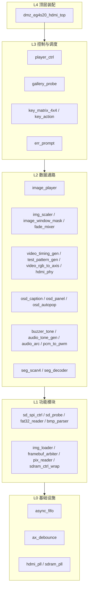
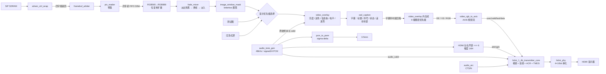

# 智播校园 SmartCampusMedia · 架构分析

> 本文是 [README.md](README.md) 的深度补充：README 讲**怎么用、怎么复现、做到哪一步**；本文讲**代码是怎么搭起来的、模块之间靠什么契约咬合、为什么这么分层**。
> 任务与完成度见 [TASKS.md](TASKS.md)，开发历史与缺陷记录见 [docs/progress.md](docs/progress.md)。
> 本文按 **2026-10-31** 的生产源码更新：显示异常（三个根因）、切图白条、C2 图片缩放、B2 换帧转场、装载看门狗与启动交接加固均已落地；最新两版位流尚未上板，完整板端验收仍待反馈。

## 1. 一句话定位

一颗 EG4S20 FPGA 独立完成「SD 卡 → FAT32 → BMP 解码 → 帧缓存 → HDMI」的全链路，**没有外接处理器、没有 CPU 软核、没有外部帧存**。

这条链路决定了整个项目的架构形状：

| 约束 | 架构后果 |
|---|---|
| 无 CPU | 文件系统、格式解析、播放调度全部要写成硬件状态机 |
| 无板级外接 DRAM | 帧缓存落在芯片封装内的 8 MiB SiP SDRAM；接口仍需保留相关时钟约束与时序检查 |
| 单一 SD 物理接口 | 探针、图库扫描、播放装载三方必须**串行复用**同一读块端口 |
| 多时钟源 | 视频 25 MHz / 串化 125 MHz / SDRAM 40 MHz 三域并存，FIFO 成为一等公民 |
| 竞赛交付 | 每个模块都要能单独仿真，出问题要能在数码管上读数 |

## 2. 分层视图

系统是**严格自底向上五层**，上层只依赖下层的接口，不反向依赖。



分层不是美术设计，它对应**可验证的边界**：每一层都能在 ModelSim 里独立跑通，不需要上板，也不需要真实 SD 卡。

## 3. 数据流主干

### 3.1 写路径（素材 → 帧缓存）

```mermaid
flowchart LR
    SD[SDHC 卡] -->|SPI Mode0<br/>CMD17 单块 512B| SPI[sd_spi_ctrl]
    SPI --> FAT[fat32_reader]
    FAT -->|IMGnnn.BMP 簇链| BMP[bmp_parser]
    BMP -->|RGB565 逐像素| SCALE[img_scaler<br/>只缩不放 / 宽 8 像素对齐]
    SCALE -->|目标窗口像素| LOAD[img_loader]
    LOAD -->|2 像素拼 32bit<br/>+ 地址 + 掩码| WF[异步写 FIFO 57bit]
    WF -->|sdr_clk 域| ARB[framebuf_arbiter]
    ARB --> WRAP[sdram_ctrl_wrap]
    WRAP --> SIP[EG_PHY_SDRAM_2M_32]
```



### 3.2 读路径（帧缓存 → 屏幕）



### 3.3 显示优先级（顶层一行代码定死）

`dmz_eg4s20_hdmi_top.v` 的 `video_base` 用嵌套三目表达式定义叠加前的画面来源：

```
video_base = !de            → 24'h000000   // 消隐区强制黑
          : (mode==2)      → 24'hFF0000   // 应急模式全屏红
          : image_ready    → (image_pixel_valid ? image888 : 24'h000000)  // 有图期间欠载补黑
          : {pr,pg,pb}                     // 完全没有图时才回落测试图
```

**含义**：`image_ready` 与「这一拍像素是否有效」是**两层独立判断**，不能压进同一个条件。有图期间读通路偶发欠载（换图瞬间后台写入抢带宽）时只补黑，绝不漏出测试图案；只有真正没有前台帧（无卡、图库为空、装载中或装载失败）才回落测试图。默认双缓冲下，重载期间继续显示旧帧，装载侧失败也保留旧帧。应急红屏优先于图片与测试图，随后统一经过 `video_overlay` 的亮度、反色和 OSD。

> 2026-10-29 板端反馈「按 KEY0/KEY1 换图时闪白色噪点」即旧写法的后果：旧式 `(image_ready && image_pixel_valid) ? image888 : {pr,pg,pb}` 在欠载拍漏出 `pattern_sel` 复位值 0（8 色彩条，最左一条是纯白）。改法见上，回归由 `tb_video_overlay` 覆盖。

### 3.4 三态模式的可见性

`player_ctrl` 的 KEY3 循环 日常(0) → 科普(1) → 应急(2)。应急态靠顶层整屏红区分；日常与科普的**画面内容相同**，若不加标记，操作者无法判断按键是否生效。因此 `video_overlay` 在 `info_mode==2'b01` 时画一个常显标记：

```
px_sci = (info_mode == 2'b01) && ((active_y <= 7) || ((active_x <= 23) && (active_y <= 31)));
```

几何上是顶部 8 像素通栏 + 左上 24×24 方块（合成 "L" 形），颜色 `24'h00_C8_E0`，与九宫格绿线、信息条深色条一起构成可辨识的 UI 层。标记**不参与**亮度缩放与反色，保证任何显示设置下都能看见。叠加合成顺序（后者被前者覆盖）：图像 → 信息条 → 波形 → 电平条 → 信息方块 → 科普标记 → 九宫格参考线。

### 3.5 缩放：只缩不放，且宽必须 8 像素对齐

`img_scaler` 串在 `bmp_parser` 与 `img_loader` 之间，把任意源尺寸映射到「640×480 内的最大内接矩形」并居中。没有它时，尺寸不符的图会被 `bmp_parser` 直接判错（数码管 `b2`、屏幕不换图）。

**只做缩小，不做放大**——这在本架构下不是取舍而是不可行：源侧每字节间隔约 16 个 25 MHz 拍（12.5 MHz SCK 的 8 bit = 640 ns），即每 16 拍才到 1 个源像素；目标侧每拍最多出 1 个。32×24 的源图要铺满 640×480，等于要求 400 倍于输入的输出能力，只能靠"先整图缓存再重扫"，而帧缓存正被显示通路占用。因此源图小于 640×480 时按 1:1 居中——顺带保证小图不失真。

算法用 Bresenham 正向累加 `phase += STEP; if (phase >= THRESH) { phase -= THRESH; 采样 }`，初值 `THRESH-1` 保证第 0 个像素必被采样。因为保持宽高比时 `dst_w/src_w == dst_h/src_h`，行列可共用**同一组** `(STEP, THRESH)`：

| 情况 | STEP | THRESH |
|---|---|---|
| 需缩小且源更宽 | 640 | `src_w` |
| 需缩小且源更高 | 480 | `src_h` |
| 不需缩小（1:1） | 1 | 1 |

`STEP <= THRESH` 恒成立，所以一次累加至多跨一个阈值、每个源像素至多命中一次，主通路里**没有任何循环、也不需要行缓冲**。模式判据用交叉乘 `src_w*480 > src_h*640`，避免 24 位乘法器。

目标尺寸是唯一的除法：21 位恢复余数、3 段流水（每段 7 级），3 拍出商；被除数上限 `2048×640 = 1,310,720 < 2²¹`。时序余量来自 `src_start` 接 `bmp_parser` 的 `hdr_ok`，而首个像素要等 `ST_PIX` 收满 B/G/R 三字节（≥48 拍）才到。

**为什么是 8 像素对齐而不是偶数对齐**：`image_player` 把 `word_addr` 截成 `word_addr[20:2]` 交给仲裁器，仲裁器按**四字突发组**（组基址 + 组内相位）寻址。8 像素 = 4 个字，因此行字数（`out_w/2`）与行首字地址（`out_off_x/2`）都必须落在 4 字边界上。只做偶数对齐时，行的组相位会逐行漂移，整帧错位。实现上是 `dw_c = {dw_c[15:3], 3'b000}`，`out_off_x` 同样对齐；代价是奇数宽源图丢最后一列。

黑边（letterbox）区域 `img_scaler` **不写**——它留在帧缓存里是上一张图的旧数据，必须由 `image_window_mask` 在送显前按 `out_w/out_h/out_off_x/out_off_y` 屏蔽成黑，否则会看到残影。

### 3.6 换帧转场：为什么是"淡出到黑"而不是交叉溶解

换图时的目标观感是"切换有过渡"，但交叉溶解（新旧两帧按 α 混合）需要**同时读两帧**：27.4 M 字/s，占 40 MHz 带宽的 68%，还得复制一份 `pix_reader` 并加双读口仲裁器——这会直接作废单读通路已经验完的全部证据。

所以采用**淡出到黑 → 全黑那一拍翻帧首 → 淡入**：

- 混合目标恒为黑，屏幕全程只需读**一帧**，不额外占带宽；
- `fade_mixer` 是纯组合的按通道缩放（`gain = level + 1`），综合结果 237 LUT + 2 DSP + **0 寄存器**；
- 2 位转场状态（`F_IDLE / F_OUT / F_IN`）+ 8 位 α，**α 只在 `vblank_rise` 推进**——转场节拍因此被帧率钉死，不受装载快慢影响；
- `FADE_FRAMES = 8` 推出 `FADE_STEP = 32`，17 个消隐周期 × 16.8 ms ≈ **286 ms** 全程。

转场期间用户再按键，必须同时撤掉 `commit_pending`、把 α 复位到全亮、状态回 `F_IDLE`——否则旧的挂起提交会在新帧装载到一半时翻帧首，把半张图翻到前台（这个坑已由 `tb_image_player` CASE 7 固化为回归项）。

## 4. 时钟、复位与跨域

| 时钟域 | 频率 | 来源 | 承载模块 |
|---|---|---|---|
| `clk` | 50 MHz | 板载晶振 R7 | 两颗 PLL 输入 |
| `clk_pixel` | 25 MHz | `hdmi_pll` | SD、文件解析、控制、像素时序、UI、**音频样本与 ACR** |
| `clk_5x` | 125 MHz | `hdmi_pll` | TMDS 串化 |
| `clk_sdr` | 40 MHz (0°) | `sdram_pll` | 仲裁器、SDRAM 控制核 |
| `clk_sdr_sft` | 40 MHz (180°) | `sdram_pll` | SiP SDRAM 接口 |

**音频没有独立时钟域。** 官方 HDMI 1.4b 发送核的 EDID / Video / Audio / ACR 四个接口全部工作在像素时钟域（APUG092 原文："HDMI1.4b Transmitter Core 的四个接口 EDID Interface、Video Interface、Audio Interface 和 ACR Interface 都是工作在 Pixel Clock 时钟域下"），所以 `audio_tone_gen` 与 `audio_arc` 直接跑在 `clk_pixel` 上，用分数分频（`sample_acc + 48000 >= 25000000` 时出一次采样使能）产生 48 kHz 节拍。

**为什么不像官方 `lab_ex5_i2s` 例程那样加一颗 12.288 MHz PLL + I2S 收发？** 那条例程用 I2S 只是为了演示"I2S 输入"这个功能，不是核的硬性要求。而 12.288 MHz 在 50 MHz 参考下除不尽，官方实际给出的是 12.295082 MHz（+0.06% 偏差），且要占用本板 4 个 PLL 中的第 3 个。既然核只要"每 1/48000 秒一个样本"，在像素域直接产生样本更省、与现有架构冲突最小。

### 复位策略

顶层用**三段式**：按键 → PLL 锁定 → 各自时钟域同步器释放。

```verilog
wire rst_async_pix = rst_n_btn && locked;              // 视频域: 只需视频 PLL 锁定
wire rst_async_sdr = rst_n_btn && locked && sdram_locked; // 存储域: 两个都要锁定
```

随后在各自时钟域用 3 位移位寄存器同步释放，避免异步撤销复位直接进入业务逻辑。SDRAM 的 0°/180° 来自同一 PLL，必须保留相位关系；只能把两颗独立 PLL 的域分成异步组。

**为什么视频域不等 SDRAM PLL？** 因为视频不依赖 SDRAM——SDRAM PLL 挂了，屏幕仍然要能出测试图，否则现场连「板子有没有起来」都判断不了。

### 跨域数据通道：`async_fifo`

像素和存储数据流通过异步 FIFO 跨域，不直接采样变化中的多比特总线。项目里有两处：

- **写 FIFO（57 bit）**：`{地址[20:2], 2'b00, 掩码[3:0], 数据[31:0]}` —— 地址、掩码、数据**必须同时跨域**，否则会出现「地址改了数据没到」的错配写入。地址以 32 bit 字计数，低 2 位补零用于形成四字对齐的组基址；并非把应用地址改成 128 bit 单位。
- **读 FIFO（32 bit）**：`pix_reader` 的 SDRAM 突发返回 → 像素时钟域连续输出。

单比特状态（`sdram_locked` 等）用同步器；读重启与完成事件用翻转位握手，多比特生产/消费计数用 Gray 码。

## 5. 存储器布局

```
一帧 = 640 × 480 = 307,200 像素
     = 153,600 个 32bit 字（每字 2 像素 RGB565）
     = 614,400 字节
     = 600 KiB
```

地址计算（`image_player.v`）：

```verilog
word_addr = pixel_y * WORDS_LINE + (pixel_x >> 1) + back_off;   // WORDS_LINE = 320
```

`back_off` 是后台帧偏移（`0` 或 `FRAME_WORDS = 153600`）。8 MiB 空间能放 13 帧，当前用掉前 2 帧做**双缓冲**：

| 缓冲 | 起始字地址 | 角色 |
|---|---|---|
| 第 0 帧 | `0` | 前台或后台，由 `front_sel` 决定 |
| 第 1 帧 | `153600` | 另一半 |

**无缝切换契约**：

1. 装载永远写**后台帧**（`back_sel = ~front_sel`），前台帧的读通路完全不受影响。
2. 只有「完整像素数到齐 + 所有写命令落盘」（`writes_complete`）才允许提交。
3. 提交先把 `commit_pending` 置位，等**下一个垂直消隐上升沿**才翻 `front_sel` —— 换帧只发生在消隐期，可见区不会撕裂。开启转场时这条窗口被拉长成「淡出 8 帧 → 全黑那一拍翻帧首 → 淡入 8 帧」（见 §3.6）；`FADE_ON=0` 则退回单拍切换。
4. `image_ready` 语义是「前台有完整帧」，首次装载才由 0 变 1；之后的装载期间保持 1，屏幕始终有画面。
5. **装载侧失败**（SD/文件/BMP/像素数/超时）保留上一帧继续显示，只置 `failed` 与错误码。
6. **存储侧故障**（仲裁错误、刷新故障、SDRAM 失锁）撤销 `image_ready`、取消挂起提交，并报告内部错误码 8；下一次装载请求会复位整个存储通路。
7. `SEAMLESS=0` 退回单帧缓冲（旧行为）：读写都落在第 0 帧，装载前共同复位存储通路，失败不保留旧帧。

重试的 `C_RESET` 固定复位窗口中，若没有有效前台帧，允许旧故障的两级同步值消退；若旧帧仍有效则继续监视故障。`C_MEM` 及其后的装载阶段仍检查存储错误，因此一次请求即可恢复已清除的粘滞源故障。

装载与存储两条通路的复位已解耦：`loader_rst_pix/sdr` 管 `img_loader`/`bmp_parser`/写 FIFO/生产计数，随装载启停；`store_rst_pix/sdr` 管 `framebuf_arbiter`/`sdram_ctrl_wrap`/`pix_reader`，只要已有在显帧就保持释放。这是「装载期间旧帧不中断」的实现基础。

### 四字组、读组节拍与刷新

`framebuf_arbiter` 默认读优先，写请求等待达到阈值后获得服务以防饥饿；读写互斥且只在完整四字组边界换向。组首预留返回信用，下一读组首至少间隔 **13 个 40 MHz 周期（325 ns）**，已开始的四拍组不受该节拍门控影响。读取按 `sdr_rd_en` 接受真实返回，不用固定延迟代替返回握手。

生产配置源为 [`ip/config/sdram/global_def.v`](ip/config/sdram/global_def.v)，`sync_src.ps1` 同步到忽略发布的 `ip/local/sdram/global_def.v`，官方核保持未修改。数据宽 32 bit、应用字地址宽 21 bit、行宽 11、bank 宽 2；40 MHz 周期为 25 ns。刷新表达式完整加括号，按 **32 ms / 2048 行** 得到名义 **625 拍**间隔，为 64 ms 保持要求留出排空和握手余量。

`self_refresh_open=0` 关闭核内自动请求。包装器刷新到期后等待两个方向的四字组完成，在组边界拉高 `ref_vld` 阻止新组；等待所有已接受的读返回排空，再静默 **16 拍**，发单拍 `App_ref_req`，等待 `core_ref` 先高后低才恢复命令。`ref_vld` 包括排空、静默、握手和故障窗口。握手超时或意外返回置位粘滞 `refresh_error`，与仲裁错误同步后映射为错误 8。物理 AREF 的实际间隔需由回归统计，不能等同于 625 拍计数值。

## 6. 单 SD 端口的独占仲裁

`sd_spi_ctrl` 只有**一组读块端口**（`blk_start / blk_addr / blk_done / blk_err / data_byte / data_valid`）。三个使用方都想读：

| 使用方 | 想读什么 | 何时 |
|---|---|---|
| `sd_probe` | LBA0、分区、BPB | 上电初始化 |
| `gallery_probe` | 根目录，数 IMG001.. 连续张数 | 探针通过后 |
| `image_player` | 图片扇区 | 扫描完成后 |

顶层用**三段严格串行**解决，`image_player.sd_ready` 同时受播放器所有权门控：

```verilog
wire sd_owner_gallery = sd_ok && !gallery_done && !gallery_fail;
wire sd_owner_player  = sd_ok && (gallery_done || gallery_fail);
wire sd_arb_start     = sd_owner_gallery ? gallery_start
                      : sd_owner_player  ? player_start : probe_start;
```

**设计要点（代码注释里明确记录）**：

1. **不能三方都接上**——`blk_start` 三个驱动源 = 多驱动，TD 直接报错；
2. **不能并行**——扫描与装载并行会让 SD 事务交错，真卡上表现为 CRC 错误/超时；
3. **判据必须用「上一段是否已完成」，不能用 `sd_ok`**——`sd_ok` 是持续电平，拉高后一直为高，无法表达「该轮到下一段了」。
4. **消费者的请求必须在所有权交接期间锁存**——`gallery_first_req` 只在扫描完成那一拍有效，而此时 `sd_owner_player` 还没到。若播放器只在 `sd_ready` 有效时采样请求，这个单拍脉冲会被丢掉，随后既不报错也不重发，只能等 4 秒超时——板上表现就是数码管 `d810`、LED6 灭、屏幕永不出图。修法是 `image_player` 用 `pending`/`pending_index` 把请求记住，在 `C_WAIT`、`C_SHOW`、`C_FAIL` 三处都能在 `sd_ready` 到达后消费它。

第一条把「三方复用」变成「**互斥所有权轮转**」，是结构决策；第四条是它的**必要补丁**：所有权交接天生存在"请求早于授权"的窗口，任何"只在授权有效时看请求"的组合逻辑都会丢脉冲。`sim/testbench/tb_startup_ownership.v` 用 9 条检查把这条钉住（`discarded_player_requests=0`、`early_player_pulses=0`）。

## 7. 可观测性设计（能看见 = 能调试）

没有 CPU，就没有 printf。所以状态必须从**硬件管脚**上读出来：

### LED[7:0]

| 位 | 含义 |
|---|---|
| LED7 | `err_active`：面向用户的错误，含无卡、零张图与各级数据故障 |
| LED6 | 装载中 |
| LED5 | SDRAM PLL 已锁定 |
| LED4 | HDMI PLL 已锁定且发射核视频已锁定 |
| LED3 | 应急模式 |
| LED2 | 读 FIFO 异常 |
| LED1 | 自动轮播中 |
| LED0 | 图片就绪 |

**LED7 由 `err_prompt` 统一产生**：卡读通但没有 `IMG001.BMP` 也会提示，避免「灯全灭但屏幕没图」被误认为正常启动。

### 数码管 4 位

| 位 | 内容 |
|---|---|
| DIG0 | 测试图序号 `pattern_sel` |
| DIG1 | 当前图片序号 `loader_index[3:0]` |
| DIG2 | 有错时为 `prompt_lo` 子码；正常时为 `image_error`（通常为 0） |
| DIG3 | 有错时为 `prompt_hi` 助记类别；正常时为播放状态 0～5 |

`err_prompt` 把原先散落在 `sd_probe` / `fat32_reader` / `bmp_parser` / `img_loader` / `image_player` 五个模块里的 1~9 内部码，归并成 **5 类"用户动作"**：`C` 卡、`F` 格式化、`0` 零张图、`b` 图片格式、`d` 数据通路，右侧一位是类内子码。归并的判据是"用户看到之后该做什么"，而不是"哪个模块报的"——同一个数字 3 在不同模块含义完全不同，直接显示没有意义。

优先级高 → 低：`sd_fail` > `gallery_fail` > `image_failed` > 零张图 > 无卡。零张图这一条此前是最容易被忽略的盲区：三个 fail 标志全 0、播放器停在空闲、屏幕出测试图、蜂鸣器不响，用户只会以为设备坏了。

超时类被拆成可区分的四个子码，而不是笼统一个"超时"：`d8` = 装载无进度（`C_LOAD` 看门狗）、`dA` = 等 `blk_done` 握手超时（`img_loader` 的 84 ms 超时）、`dB` = 等 SDRAM 初始化超时、`dC` = 等写完成超时。现场只要能读到这一位，就基本能定位是哪一段通路停了。完整提示表与 16 键表见 [README](README.md#五操作与诊断)。

### 诊断探针（按需例化，不占正式通路）

- `image_path_probe.v`：在全链路上打 4 个粘滞观察点，输出 16 bit `stages`，每个 nibble 记录「见没见到数据 / 见没见过红色 F800 / 见没见到非白」，用于白屏类故障四级定位。
- `image_readback_diag.v`：整帧写完后直接读回逐字比较。
- `sdram_frame_diag.v`：SDRAM 帧区完整性诊断。

这些模块的共同套路是 **observe-only**：只看不改，粘滞置位，只在单一时钟域置位后同步过域。

## 8. 设计取舍与已知缺陷

| 取舍 | 现状 | 代价 |
|---|---|---|
| 双缓冲无缝切换 | 装载写后台帧，垂直消隐换帧首，前台不间断 | 占用 1200 KiB；装载侧失败保留旧帧，须靠数码管/LED 判故障 |
| 单 SD 三方串行 | 结构简单、事务不交错 | 换图时扫描与装载不能重叠 |
| SDHC-only | 不支持 SDSC/exFAT/LFN/目录递归 | 素材必须放到根目录、短文件名、按序编号 |
| 无自动热插拔恢复 | KEY10 可重扫图库，卡初始化失败仍需复位恢复 | 重扫目录不等同于重新初始化物理卡 |
| 图库运行时扫描 | 上限 31 张，遇第一个缺失即停 | 编号必须连续，不能有空洞 |
| 缩放只缩不放 | 任意尺寸都能吃下，主通路无循环、无行缓冲 | 小于 640×480 的图 1:1 居中，不铺满；奇数宽丢最后一列 |
| 转场用淡出到黑 | 全程单路读，不额外占带宽；`fade_mixer` 零寄存器 | 不是交叉溶解，观感是"暗一下再亮" |
| 看门狗按扇区进度计时 | 慢卡整帧装满 4 秒不再误报 | 单扇区真停滞仍需 4 秒才报 |
| 请求在所有权交接期锁存 | 单拍请求不丢，启动路径确定 | 多一级 `pending` 状态，三处状态都要消费 |
| SiP SDRAM 40 MHz | 同一 PLL 的 0°/180° 均经 BUFG，保留相关时序分析 | 13 拍读组间隔、刷新和换向使有效吞吐低于原始总线带宽 |

### 验证与板端状态（2026-10-31）

- **两版最新位流都还没上板**：`reports/flashable_20261030/smartcampus_media_20261030.bit`（15:39）与 `reports/watchdog_20261030/smartcampus_media_watchdog_20261030.bit`（22:50）。用户已确认能显示的最后一版是 10-29 的 `hdmi_display_fix.bit`，它修好了深色区周期白条；其后两版把切图白条、装载看门狗、启动交接加固一并合入，等待重启验收。
- 七套行为回归最近一次全量实跑 2026-10-31 全部通过：**848,063 条断言、1505 秒**（`unit` 853 / `frontend` 829 / `storage` 220,642 / `audio` 24 / `startup` 12 / `display` 614,405 / `image` 11,298）。明细与判定口径见 [TEST_COVERAGE.md](TEST_COVERAGE.md)。
- 冻结后真实 SDRAM 核原图链有 614,407 次检查，零错且帧完全一致；保持 64 ms 后两次回读共 307,200 字零错。读组间隔、刷新排空、握手超时、粘滞故障和单次重试都有正负对照，见[显示修复记录](docs/display_fix_2026-10-29.md)。
- watchdog 版构建的 setup WNS **+1.935 ns**、hold WNS **+0.003 ns**，TNS 均为 0，0 违例端点（10,512 端点 / 578,116 路径）；读 DQ **+1.935 ns** 仍是全局最小余量，[时序报告](reports/watchdog_20261030/timing.txt)。hold 余量只有 3 ps，温漂/压漂下有偶发采样风险，这一条不能当成"稳过"。
- 150 MHz 下的 −7.232 ns 只是历史对照，不再代表当前状态；40 MHz 的定频推导见 [README](README.md#八验证与证据)。
- 功能引脚模型、串行逆解码和 STA 各自覆盖不同边界；当前约束下时序通过不等于完整板端验收。外部 IO 延迟约束、PLL 本地反馈和 SiP 位置告警仍需按 [README](README.md#九已知限制与后续) 跟踪。
- 16 个键位均已实现；电平条和波形已实现。音频仍是状态音调，FFT 频谱与音频文件播放尚未实现。

### 已经解决的经典故障：DQM 掩码

白屏故障的根因在 `framebuf_arbiter`——SDRAM 的 DQM **同时影响读和写**：

| 场景 | DQM 取值 |
|---|---|
| 真实写入 | 请求的字节掩码 |
| 分组补写 | `4'hF` |
| **读取 / 空闲** | **`4'h0`** |

最后一行是修复点：读取时若沿用写掩码，读回的正常数据会被掩码屏蔽掉，表现为整帧纯白。细节见 [docs/image_dm_fix_2026-10-20.md](docs/image_dm_fix_2026-10-20.md)。

## 9. 模块接口契约速查

| 模块 | 关键契约 |
|---|---|
| `sd_spi_ctrl` | 初始化 390.625 kHz，读块 12.5 MHz；`blk_start` 单拍脉冲，`data_valid` 逐字节，每字节一拍 |
| `sd_probe` | 上电后自动 `init_start`，`PROBE_DELAY_CYCLES=200_000` 等卡上电；`sd_ok` 是**持续电平** |
| `fat32_reader` | 输入扇区，输出文件簇链；支持 MBR 分区卷与 LBA0 无分区卷 |
| `bmp_parser` | 默认仅 640×480 / 24 bit / 无压缩；`CHECK_SIZE=1`（当前生产配置）放行任意尺寸交给 `img_scaler`，但仍挡 0 尺寸；处理 BGR 顺序与自底向上行序；输出 RGB565 |
| `img_scaler` | 串在 `bmp_parser` 与 `img_loader` 之间，由 `image_player` 例化。只缩不放、保持宽高比、居中；21 位恢复余数除法器 3 段流水、3 拍出商；Bresenham 行列共用一组 `(STEP,THRESH)` 且 `STEP<=THRESH` 恒成立；`dst_w` 与 `out_off_x` 强制 8 像素对齐；黑边本模块不写（见 §3.5） |
| `img_loader` | `CHAIN_MAX=4096`；两像素拼 32 bit；地址 = `y*320 + (x>>1)`；`BLK_TIMEOUT=2,097,152`≈84 ms@25 MHz，**必须大于** `sd_spi_ctrl` 的 `TOKEN_TIMEOUT=1,048,576`≈42 ms，超时报 `E_BLKTMO=4'd10` |
| `image_player` | 索引 0-based；`pending`/`pending_index` 锁存跨所有权交接的请求；`LOAD_TIMEOUT=100_000_000` 是**单扇区无进度**上限（每 `blk_done` 喂狗）；`error_code` 分段 8=SDRAM / 9=装载无进度 / 11=等 SDRAM 初始化 / 12=等写完成 |
| `fade_mixer` | 读侧第一级，纯组合按通道缩放，`gain = level + 1`；2 位状态 `F_IDLE/F_OUT/F_IN` + 8 位 α，α **只在 `vblank_rise` 推进**；`FADE_FRAMES=8 → FADE_STEP=32`，全程约 286 ms；综合 237 LUT + 2 DSP + 0 寄存器（见 §3.6） |
| `image_window_mask` | 按 `out_w/out_h/out_off_x/out_off_y` 把 letterbox 区域屏蔽成黑。`img_scaler` 不写黑边，少了这一级上一张图的残影会露出来 |
| `framebuf_arbiter` | 读优先、防写饥饿；完整四字组、相邻读组首至少 13 拍；精确在飞计数与重启排空，回绕边界随 `rd_base` 重算；DQM 规则见 §8 |
| `sdram_ctrl_wrap` | 写通道无 ready；以 `ref_vld` 避让，`sdr_rd_en` 接受返回；生产用手动刷新与粘滞 `refresh_error`，行为模型的固定 10 拍读延迟不代替真核验证 |
| `pix_reader` | 按行预取，异步读 FIFO 平滑突发到像素流 |
| `video_timing_gen` | 800×525 总时序 @25 MHz ≈ 59.52 Hz；消隐期坐标归零 |
| `video_rgb_to_axis` | 每拍 `valid<=de`、`data<=rgb`；VS 跳变后下一行首拍发一次 `user`；`x_cnt==639` 那拍发 `last`。**核要求一行数据连续输入**，DE 直通天然满足 |
| `video_overlay` | 纯组合、零延迟。合成顺序：图像 → **字幕** → 信息条 → 波形 → 电平条 → 信息方块 → 科普标记 → 九宫格。亮度与反色只作用于图像层，UI 层颜色固定。字幕层由内部例化的 `osd_caption` 产出 |
| `osd_font8x16` | 8×16 点阵字模 ROM，41 个字形（` -./0-9:A-Z`）。纯组合 `case ({char_code, row})`，未收录字符输出 0（空白，不画乱码）。**由 `scripts/gen_osd_font8.py` 生成，不手改** |
| `osd_strings` | 16 行 × 64 列字符码表，只列非空格。`#`/`*` 是序号十位/个位占位符，替换逻辑在 `osd_caption` 里。**由 `scripts/gen_osd_strings.py` 生成，不手改** |
| `osd_caption` | 字幕渲染：四路文字共用一套 ROM（单路渲染，因像素任一时刻只属于一处）；标题/序号/状态/标语四条 y 带互不重叠；标语用 9 bit `scroll_px` 滚动（512 像素 = 64 字符 = 整轮，回绕无跳变）；衬底带把图像压到 1/4 亮度 |
| `osd_panel` / `osd_autopop` | 参数面板字符渲染；`osd_autopop` 在参数变化时自动弹出约 2.5 秒后自隐，**不占键号** |
| `key_action` | KEY7~KEY14 统一译码成亮度 / 反色 / 倍率 / 重扫 / 九宫格 / 信息条 / 音频图层 / 蜂鸣器静音；顶层不再单独消费这 8 个键 |
| `err_prompt` | 把五个模块的 1~12 内部码归并成 5 类用户动作（C/F/0/b/d）+ 类内子码；优先级 `sd_fail > gallery_fail > image_failed > 零张图 > 无卡`；1.5 秒静默后鸣响 3 秒（`ALARM_DELAY = CLK_FREQ_HZ*3/2`） |
| `video_content_mux` | 三级优先：应急红 > 图片 > 测试图。`image_ever_ready` 是粘滞标志：**首张图就绪后即使 `image_ready` 落下也补黑，不再回落彩条**，这是切图竖白条的根因修复 |
| `dmz_eg4s20_hdmi_top`（显示优先级） | `image_ready` 与 `image_pixel_valid` 分两层判断：有图期间欠载补黑，只有完全无图才回落测试图（见 §3.3） |
| `audio_tone_gen` | `CLK_FREQ_HZ=25M`、`SAMPLE_RATE_HZ=48k`；静音时**仍发 `valid`**、样本填 0（核要求输入速率等于采样率，停发 valid 会被当成流中断）；音高由 `playback_state` 选 |
| HDMI 音量分支 | 顶层 signed 24 bit 左右声道各 `>>> 6`，幅度为原 PCM 的 1/64（−36.12 dB）；3.5 mm 与叠加层保持原幅度，valid / ACR 不变 |
| `audio_arc` | `ACR_N=6144`；`AUDIO_DIV = ACR_N>>7 = 48`，即每 48 个样本发一包；`cts` 每拍自增、发包容错后清零 |
| `hdmi_phy` / `lane_lvds_10_1` | 输入 10 bit 先**全位反序**，再 2 bit/拍移位，`EG_LOGIC_ODDR(d1=data[0], d0=data[1])` 输出。串化域不复位（与官方一致） |
| `hdmi_1_4b_transmitter_core_wrapper` | 官方加密核保持不改；真实核仿真使用已支持解密的 Questa 环境，常规 ASE 回归不覆盖核内部；`I_rst` 高有效，`VIDEO_TPG="Disable"` 才使用外部视频 |
| `player_ctrl` | 索引 0-based、`loader_index` 1-based；**上电首图不会自动发 `img_switch_req`**，必须由顶层补脉冲 |

最后一条是顶层 `player_load_req = switch_req || gallery_first_req` 的由来——`gallery_first_req` 恰好是「扫描完成且至少 1 张」的那一拍，用它做上电首图请求比另做脉冲发生器更准，且此时 SD 事务已全部结束。

## 10. 工程化配套

| 脚本 | 作用 |
|---|---|
| `scripts/sync_src.ps1` | `rtl/` → `project/src`、`project/hdmi`；统一 SDRAM 配置 → `ip/local/sdram/global_def.v`；增量同步并跑 lint |
| `scripts/lint_verilog.py` | 静态检查：时序块禁阻塞赋值、组合块禁非阻塞、禁多驱动 |
| `sim/scripts/run_*_regression.ps1` | 行为、播放器、前端、音频及真实核刷新/保持回归；明确通过标记和源码 SHA256 绑定证据 |
| `project/flow_c2_scaler.tcl` / `flow_b2_fade.tcl` / `flow_flashable_20261030.tcl` / `flow_watchdog_20261030.tcl` | C2 缩放、B2 转场、烧录候选、装载看门狗四版构建；每个都校验 SWNS/HWNS 正则，负值直接 `exit 3`，并各自保留独立位流与时序/面积/覆盖证据 |
| `scripts/check_image_path_diag.py` | 核对源码、bit 哈希与证据关联 |

**证据链原则**：每条历史记录绑定其对应源码与构建版本，不能代替后续改动后的重新验证；行为模型不得当真实 IP 宣称；功能通过不得当时序收敛宣称。

## 11. 一页速记

```
SD 卡 → sd_spi_ctrl → fat32_reader → bmp_parser → img_scaler → img_loader
                                                                   ↓ (57bit 异步 FIFO)
                                 framebuf_arbiter → sdram_ctrl_wrap → SiP SDRAM
                                                                   ↑
                                 pix_reader ← ← ← ← ← ← ← ← ← ← ← ← ┘ (32bit 异步 FIFO)
                                                                   ↓
                    fade_mixer → image_window_mask → video_content_mux → video_overlay
                                                                   ↓
                    video_timing_gen → video_rgb_to_axis → HDMI1.4 核 → 串化 → HDMI
                                          ↑
                            osd_caption（osd_strings + osd_font8x16，字幕层）
                                                              ↑
                        audio_tone_gen → HDMI专用 >>>6 ───────┘（48kHz PCM）
                                    └→ PWM / 电平与波形（原幅度）
                             audio_arc ─────────────┘（ACR）
                                                     ↑
              player_ctrl / key_matrix / key_action / gallery_probe / err_prompt（控制面）
```

三条铁律：
1. **数据流跨域走异步 FIFO**，状态用同步器、事件用握手、多比特计数用 Gray 码。
2. **单端口必须互斥轮转**，判据用「完成」不用「电平」。
3. **看不见就调不动**：失败路径必须有可见反馈（测试图、LED、数码管）。

## 许可证

本文档与 [README.md](README.md) 同为项目自研内容，随仓库以 [MIT License](LICENSE) 发布。
