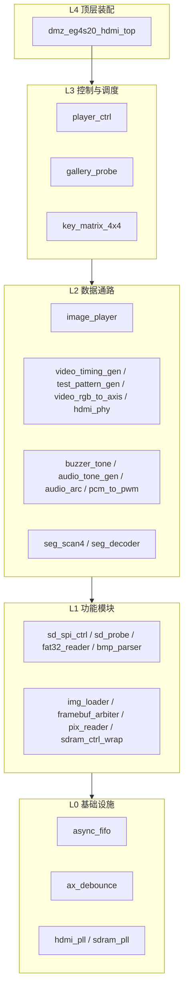
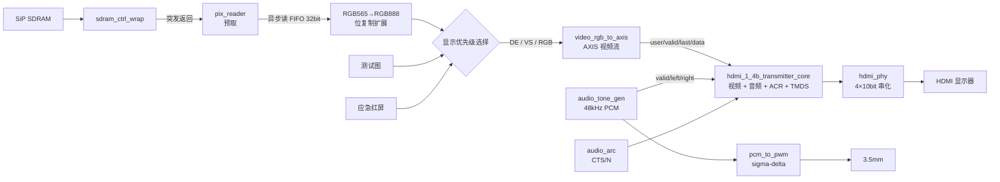

# 智播校园 SmartCampusMedia · 架构分析

> 本文是 [README.md](README.md) 的深度补充：README 讲**怎么用、怎么复现、做到哪一步**；本文讲**代码是怎么搭起来的、模块之间靠什么契约咬合、为什么这么分层**。
> 任务与完成度见 [TASKS.md](TASKS.md)，开发历史与缺陷记录见 [docs/progress.md](docs/progress.md)。

## 1. 一句话定位

一颗 EG4S20 FPGA 独立完成「SD 卡 → FAT32 → BMP 解码 → 帧缓存 → HDMI」的全链路，**没有外接处理器、没有 CPU 软核、没有外部帧存**。

这条链路决定了整个项目的架构形状：

| 约束 | 架构后果 |
|---|---|
| 无 CPU | 文件系统、格式解析、播放调度全部要写成硬件状态机 |
| 无外部 DRAM | 帧缓存只能落在芯片封装内的 8 MiB SiP SDRAM，管脚不可见、时序不可控 |
| 单一 SD 物理接口 | 探针、图库扫描、播放装载三方必须**串行复用**同一读块端口 |
| 多时钟源 | 视频 25 MHz / 串化 125 MHz / SDRAM 150 MHz 三域并存，FIFO 成为一等公民 |
| 竞赛交付 | 每个模块都要能单独仿真，出问题要能在数码管上读数 |

## 2. 分层视图

系统是**严格自底向上五层**，上层只依赖下层的接口，不反向依赖。



分层不是美术设计，它对应**可验证的边界**：每一层都能在 ModelSim 里独立跑通，不需要上板，也不需要真实 SD 卡。

## 3. 数据流主干

### 3.1 写路径（素材 → 帧缓存）

```mermaid
flowchart LR
    SD[SDHC 卡] -->|SPI Mode0<br/>CMD17 单块 512B| SPI[sd_spi_ctrl]
    SPI --> FAT[fat32_reader]
    FAT -->|IMGnnn.BMP 簇链| BMP[bmp_parser]
    BMP -->|RGB565 逐像素| LOAD[img_loader]
    LOAD -->|2 像素拼 32bit<br/>+ 地址 + 掩码| WF[异步写 FIFO 57bit]
    WF -->|sdr_clk 域| ARB[framebuf_arbiter]
    ARB --> WRAP[sdram_ctrl_wrap]
    WRAP --> SIP[EG_PHY_SDRAM_2M_32]
```



### 3.2 读路径（帧缓存 → 屏幕）



### 3.3 显示优先级（顶层一行代码定死）

`dmz_eg4s20_hdmi_top.v:171-172` 用一条嵌套三目表达式定义了整屏的仲裁规则：

```
video_rgb = !de            → 24'h000000   // 消隐区强制黑
          : (mode==2)      → 24'hFF0000   // 应急模式全屏红
          : (image_ready && image_pixel_valid) → image888
          : {pr,pg,pb}                     // 回落测试图
```

**含义**：`image_ready` 没拉高之前（装载中、装载失败、像素未就绪），屏幕永远显示测试图而不是黑屏或残影。这是一条「**失败也必须看得见**」的现场调试原则。

## 4. 时钟、复位与跨域

| 时钟域 | 频率 | 来源 | 承载模块 |
|---|---|---|---|
| `clk` | 50 MHz | 板载晶振 R7 | 两颗 PLL 输入 |
| `clk_pixel` | 25 MHz | `hdmi_pll` | SD、文件解析、控制、像素时序、UI、**音频样本与 ACR** |
| `clk_5x` | 125 MHz | `hdmi_pll` | TMDS 串化 |
| `clk_sdr` | 150 MHz (0°) | `sdram_pll` | 仲裁器、SDRAM 控制核 |
| `clk_sdr_sft` | 150 MHz (180°) | `sdram_pll` | SiP SDRAM 接口 |

**音频没有独立时钟域。** 官方 HDMI 1.4b 发送核的 EDID / Video / Audio / ACR 四个接口全部工作在像素时钟域（APUG092 原文："HDMI1.4b Transmitter Core 的四个接口 EDID Interface、Video Interface、Audio Interface 和 ACR Interface 都是工作在 Pixel Clock 时钟域下"），所以 `audio_tone_gen` 与 `audio_arc` 直接跑在 `clk_pixel` 上，用分数分频（`sample_acc + 48000 >= 25000000` 时出一次采样使能）产生 48 kHz 节拍。

**为什么不像官方 `lab_ex5_i2s` 例程那样加一颗 12.288 MHz PLL + I2S 收发？** 那条例程用 I2S 只是为了演示"I2S 输入"这个功能，不是核的硬性要求。而 12.288 MHz 在 50 MHz 参考下除不尽，官方实际给出的是 12.295082 MHz（+0.06% 偏差），且要占用本板 4 个 PLL 中的第 3 个。既然核只要"每 1/48000 秒一个样本"，在像素域直接产生样本更省、与现有架构冲突最小。

### 复位策略

顶层用**三段式**：按键 → PLL 锁定 → 各自时钟域同步器释放。

```verilog
wire rst_async_pix = rst_n_btn && locked;              // 视频域: 只需视频 PLL 锁定
wire rst_async_sdr = rst_n_btn && locked && sdram_locked; // 存储域: 两个都要锁定
```

随后各自用 3 位移位寄存器同步释放（`dmz_eg4s20_hdmi_top.v:49-57`），保证复位撤销沿不在同一拍跳变。

**为什么视频域不等 SDRAM PLL？** 因为视频不依赖 SDRAM——SDRAM PLL 挂了，屏幕仍然要能出测试图，否则现场连「板子有没有起来」都判断不了。

### 跨域唯一通道：`async_fifo`

跨时钟域**只允许走异步 FIFO**，不允许直接采样多比特总线。项目里有两处：

- **写 FIFO（57 bit）**：`{地址[20:2], 2'b00, 掩码[3:0], 数据[31:0]}` —— 地址、掩码、数据**必须同时跨域**，否则会出现「地址改了数据没到」的错配写入。低 2 位补零是因为 SDRAM 按字寻址。
- **读 FIFO（32 bit）**：`pix_reader` 的 SDRAM 突发返回 → 像素时钟域连续输出。

单比特状态（`sdram_locked` 等）用双触发器同步器；多比特计数器用 Gray 码。

## 5. 存储器布局

```
一帧 = 640 × 480 = 307,200 像素
     = 153,600 个 32bit 字（每字 2 像素 RGB565）
     = 614,400 字节
     = 600 KiB
```

地址计算（`image_player.v`）：

```verilog
word_addr = pixel_y * WORDS_LINE + (pixel_x >> 1) + back_off;   // WORDS_LINE = 320
```

`back_off` 是后台帧偏移（`0` 或 `FRAME_WORDS = 153600`）。8 MiB 空间能放 13 帧，当前用掉前 2 帧做**双缓冲**：

| 缓冲 | 起始字地址 | 角色 |
|---|---|---|
| 第 0 帧 | `0` | 前台或后台，由 `front_sel` 决定 |
| 第 1 帧 | `153600` | 另一半 |

**无缝切换契约**：

1. 装载永远写**后台帧**（`back_sel = ~front_sel`），前台帧的读通路完全不受影响。
2. 只有「完整像素数到齐 + 所有写命令落盘」（`writes_complete`）才允许提交。
3. 提交先把 `commit_pending` 置位，等**下一个垂直消隐上升沿**才翻 `front_sel` —— 换帧只发生在消隐期，可见区不会撕裂。
4. `image_ready` 语义是「前台有完整帧」，首次装载才由 0 变 1；之后的装载期间保持 1，屏幕始终有画面。
5. **装载侧失败**（SD/文件/BMP/像素数/超时）保留上一帧继续显示，只置 `failed` 与错误码。
6. **存储侧故障**（仲裁错误、SDRAM 失锁）必须先撤 `image_ready`，因为显示通路的复位释放依赖它，否则粘滞错误永远清不掉。
7. `SEAMLESS=0` 退回单帧缓冲（旧行为）：读写都落在第 0 帧，装载前共同复位存储通路，失败不保留旧帧。

装载与存储两条通路的复位已解耦：`loader_rst_pix/sdr` 管 `img_loader`/`bmp_parser`/写 FIFO/生产计数，随装载启停；`store_rst_pix/sdr` 管 `framebuf_arbiter`/`sdram_ctrl_wrap`/`pix_reader`，只要已有在显帧就保持释放。这是「装载期间旧帧不中断」的实现基础。

## 6. 单 SD 端口的独占仲裁

`sd_spi_ctrl` 只有**一组读块端口**（`blk_start / blk_addr / blk_done / blk_err / data_byte / data_valid`）。三个使用方都想读：

| 使用方 | 想读什么 | 何时 |
|---|---|---|
| `sd_probe` | LBA0、分区、BPB | 上电初始化 |
| `gallery_probe` | 根目录，数 IMG001.. 连续张数 | 探针通过后 |
| `image_player` | 图片扇区 | 扫描完成后 |

顶层用**三段严格串行**解决（`dmz_eg4s20_hdmi_top.v:112-115`）：

```verilog
wire sd_owner_gallery = sd_ok && !gallery_done && !gallery_fail;
wire sd_owner_player  = sd_ok && !sd_owner_gallery;
wire sd_arb_start     = sd_owner_gallery ? gallery_start
                      : sd_owner_player  ? player_start : probe_start;
```

**设计要点（代码注释里明确记录）**：

1. **不能三方都接上**——`blk_start` 三个驱动源 = 多驱动，TD 直接报错；
2. **不能并行**——扫描与装载并行会让 SD 事务交错，真卡上表现为 CRC 错误/超时；
3. **判据必须用「上一段是否已完成」，不能用 `sd_ok`**——`sd_ok` 是持续电平，拉高后一直为高，无法表达「该轮到下一段了」。

第一条把「三方复用」变成「**互斥所有权轮转**」，这是全项目最值得抄的一处结构决策。

## 7. 可观测性设计（能看见 = 能调试）

没有 CPU，就没有 printf。所以状态必须从**硬件管脚**上读出来：

### LED[7:0]（`dmz_eg4s20_hdmi_top.v:196`）

| 位 | 含义 |
|---|---|
| LED7 | SD 失败 **或** 图库扫描失败 **或** 图片装载失败（三合一） |
| LED6 | 装载中 |
| LED5 | SDRAM PLL 已锁定 |
| LED4 | HDMI PLL 已锁定 |
| LED3 | 应急模式 |
| LED2 | 读 FIFO 异常 |
| LED1 | 自动轮播中 |
| LED0 | 图片就绪 |

**LED7 的三合一是有意为之**：现场换一张没有 `IMGnnn.BMP` 的卡，如果只有 SD 探针失败才亮灯，会表现为「灯全灭但屏幕没图」——看起来像正常启动。合并语义保证**任何资源不可用都点亮同一个告警灯**。

### 数码管 4 位

| 位 | 内容 |
|---|---|
| DIG0 | 测试图序号 `pattern_sel` |
| DIG1 | 当前图片序号 `loader_index[3:0]` |
| DIG2 | 错误码（`error_value`） |
| DIG3 | 错误来源：0=正常 / 1=SD / 2=图片 / 3=图库 |

错误码优先级 `gallery_fail ? gallery_err : (sd_fail ? probe_err : image_error)`——**按「谁先发生」排**，让现场一眼看出故障停在哪一级。

### 诊断探针（按需例化，不占正式通路）

- `image_path_probe.v`：在全链路上打 4 个粘滞观察点，输出 16 bit `stages`，每个 nibble 记录「见没见到数据 / 见没见过红色 F800 / 见没见到非白」，用于白屏类故障四级定位。
- `image_readback_diag.v`：整帧写完后直接读回逐字比较。
- `sdram_frame_diag.v`：SDRAM 帧区完整性诊断。

这些模块的共同套路是 **observe-only**：只看不改，粘滞置位，只在单一时钟域置位后同步过域。

## 8. 设计取舍与已知缺陷

| 取舍 | 现状 | 代价 |
|---|---|---|
| 双缓冲无缝切换 | 装载写后台帧，垂直消隐换帧首，前台不间断 | 占用 2 帧 SDRAM（1.2 MiB）；装载侧失败时屏幕仍显示旧帧，须靠数码管/LED 判故障 |
| 单 SD 三方串行 | 结构简单、事务不交错 | 换图时扫描与装载不能重叠 |
| SDHC-only | 不支持 SDSC/exFAT/LFN/目录递归 | 素材必须放到根目录、短文件名、按序编号 |
| 无热插拔恢复 | 插好卡按复位重新初始化 | 现场换卡要按复位键 |
| 图库运行时扫描 | 上限 31 张，遇第一个缺失即停 | 编号必须连续，不能有空洞 |
| SiP SDRAM 150 MHz | 无外部 IO，省管脚 | 布线后 setup WNS **−7.232 ns 未收敛**（发布阻塞项） |

### 时序状态（重要，不要误读）

- 功能仿真全绿（前端 391 条 PASS、图片 614,406 项检查、真实加密核 614,406 项）。
- **仿真通过 ≠ 时序收敛**。正式顶层布线后 SiP 接口 setup WNS −7.232 ns / TNS −335.004 ns，hold WNS +0.023 ns，构建脚本会返回失败码。
- 上板证据来自**独立诊断工程 `image_dm_fix`**（数码管 7777、LED0～5 亮、中央红块出现），**不是正式顶层**。

### 已经解决的经典故障：DQM 掩码

白屏故障的根因在 `framebuf_arbiter`——SDRAM 的 DQM **同时影响读和写**：

| 场景 | DQM 取值 |
|---|---|
| 真实写入 | 请求的字节掩码 |
| 分组补写 | `4'hF` |
| **读取 / 空闲** | **`4'h0`** |

最后一行是修复点：读取时若沿用写掩码，读回的正常数据会被掩码屏蔽掉，表现为整帧纯白。细节见 [docs/image_dm_fix_2026-10-20.md](docs/image_dm_fix_2026-10-20.md)。

## 9. 模块接口契约速查

| 模块 | 关键契约 |
|---|---|
| `sd_spi_ctrl` | 初始化 390.625 kHz，读块 12.5 MHz；`blk_start` 单拍脉冲，`data_valid` 逐字节，每字节一拍 |
| `sd_probe` | 上电后自动 `init_start`，`PROBE_DELAY_CYCLES=200_000` 等卡上电；`sd_ok` 是**持续电平** |
| `fat32_reader` | 输入扇区，输出文件簇链；支持 MBR 分区卷与 LBA0 无分区卷 |
| `bmp_parser` | 仅 640×480 / 24 bit / 无压缩；处理 BGR 顺序与自底向上行序；输出 RGB565 |
| `img_loader` | `CHAIN_MAX=4096`；两像素拼 32 bit；地址 = `y*320 + (x>>1)` |
| `framebuf_arbiter` | 写优先、读按扫描行预取；DQM 规则见 §8；读侧回绕边界随 `rd_restart` 捕获的基址重算，支持双缓冲任意帧首 |
| `sdram_ctrl_wrap` | 读延迟固定 10 拍；写通道无反压；封装中同时提供**行为模型**用于仿真 |
| `pix_reader` | 按行预取，异步读 FIFO 平滑突发到像素流 |
| `video_timing_gen` | 800×525 总时序 @25 MHz ≈ 59.52 Hz；消隐期坐标归零 |
| `video_rgb_to_axis` | 每拍 `valid<=de`、`data<=rgb`；VS 跳变后下一行首拍发一次 `user`；`x_cnt==639` 那拍发 `last`。**核要求一行数据连续输入**，DE 直通天然满足 |
| `audio_tone_gen` | `CLK_FREQ_HZ=25M`、`SAMPLE_RATE_HZ=48k`；静音时**仍发 `valid`**、样本填 0（核要求输入速率等于采样率，停发 valid 会被当成流中断）；音高由 `playback_state` 选 |
| `audio_arc` | `ACR_N=6144`；`AUDIO_DIV = ACR_N>>7 = 48`，即每 48 个样本发一包；`cts` 每拍自增、发包容错后清零 |
| `hdmi_phy` / `lane_lvds_10_1` | 输入 10 bit 先**全位反序**，再 2 bit/拍移位，`EG_LOGIC_ODDR(d1=data[0], d0=data[1])` 输出。串化域不复位（与官方一致） |
| `hdmi_1_4b_transmitter_core_wrapper` | 加密核（Anlogic RSA + AES128-CBC），**不可修改、不可在 ModelSim ASE 中仿真**；`I_rst` 是**高有效**（顶层接 `~rst_n`）；`VIDEO_TPG` 必须 `"Disable"` 才用外部视频 |
| `player_ctrl` | 索引 0-based、`loader_index` 1-based；**上电首图不会自动发 `img_switch_req`**，必须由顶层补脉冲 |

最后一条是顶层 `player_load_req = switch_req || gallery_first_req` 的由来——`gallery_first_req` 恰好是「扫描完成且至少 1 张」的那一拍，用它做上电首图请求比另做脉冲发生器更准，且此时 SD 事务已全部结束。

## 10. 工程化配套

| 脚本 | 作用 |
|---|---|
| `scripts/sync_src.ps1` | `rtl/` → `project/src`、`project/hdmi` 增量同步并跑 lint |
| `scripts/lint_verilog.py` | 静态检查：时序块禁阻塞赋值、组合块禁非阻塞、禁多驱动 |
| `sim/scripts/run_*_regression.ps1` | 四套回归；把源码 SHA256 绑进报告，运行中源码变动即判定证据失效 |
| `project/flow_s6_bit.tcl` | TD 全流程；**时序失败时返回失败码**，即使 bit 已生成 |
| `scripts/check_image_path_diag.py` | 核对源码、bit 哈希与证据关联 |

**证据链原则**：每条历史记录绑定其对应源码与构建版本，不能代替后续改动后的重新验证；行为模型不得当真实 IP 宣称；功能通过不得当时序收敛宣称。

## 11. 一页速记

```
SD 卡 → sd_spi_ctrl → fat32_reader → bmp_parser → img_loader
                                                    ↓ (57bit 异步 FIFO)
                              framebuf_arbiter → sdram_ctrl_wrap → SiP SDRAM
                                                    ↑
                              pix_reader ← ← ← ← ←┘ (32bit 异步 FIFO)
                                                    ↓
                    video_timing_gen → video_rgb_to_axis → hdmi_1_4b 核 → hdmi_phy → HDMI
                                                             ↑
                            audio_tone_gen + audio_arc ──────┘（音频与 ACR）
                                                    ↑
                              player_ctrl / key_matrix / gallery_probe（控制面）
```

三条铁律：
1. **跨域只走异步 FIFO**，多比特绝不直采。
2. **单端口必须互斥轮转**，判据用「完成」不用「电平」。
3. **看不见就调不动**：失败路径必须有可见反馈（测试图、LED、数码管）。

## 许可证

本文档与 [README.md](README.md) 同为项目自研内容，随仓库以 [MIT License](LICENSE) 发布。
