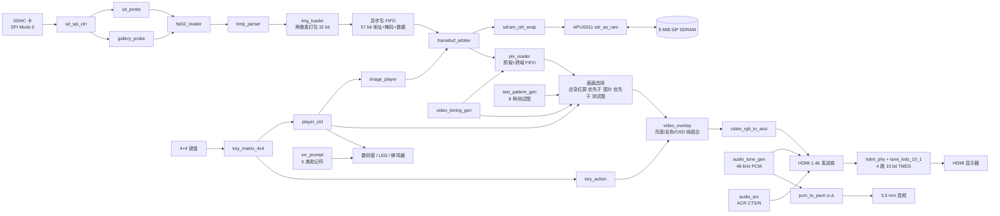

# 智播校园 SmartCampusMedia

[](LICENSE)

基于安路 EG4S20 FPGA 的校园多媒体信息发布与应急提示终端。SD 卡读取、FAT32 解析、BMP 解码、帧缓存、播放控制、HDMI 视频与音频输出全部由 FPGA 逻辑实现，**没有外接处理器、没有软核、没有运行任何软件**。

面向全国大学生嵌入式芯片与系统设计竞赛 2026 FPGA 创新设计赛道，选题一：基于安路 EG4S20 的 HDMI 多媒体播放系统。

> 本文讲**怎么用、怎么复现、现在做到哪一步**。
> 想看**为什么这么设计**——分层、数据流、时钟与跨域、存储器布局、仲裁、可观测性、设计取舍，见 [架构分析](ARCHITECTURE.md)。
> 任务清单与完成度见 [TASKS.md](TASKS.md)；按日期的发展过程见 [开发进度](docs/progress.md)。

---

## 一、当前状态（截至 2026-10-27）

**能做什么**：插上写好 BMP 的 SDHC 卡，上电后自动扫描图库、装载图片、以 640×480@59.5 Hz 送上 HDMI 显示，同时把同一份 PCM 样本嵌入 HDMI 音频并输出到板载 3.5 mm；16 个按键控制播放、轮播、应急，以及亮度、反色、九宫格、信息条、音频电平条等画面后处理。

**验证到哪一步**：行为仿真（ModelSim）全绿，正式顶层 `dmz_eg4s20_hdmi_top` 的 elaborate → 综合 → 布局 → 布线 → bitgen 全流程通过（2026-10-27 15:23 按修复后源码重新出过 bit）。**150 MHz 逻辑自身域已收敛（+0.326 ns），SiP SDRAM 接口时序仍未收敛，也没有上过板。**

> 关于 bit 与最终时序的关系：2026-10-27 的最终构建由 [`flow_s6_bit.tcl`](project/flow_s6_bit.tcl) 完成，走满 bitgen，`project/hdmi_td_Runs/phy_1/hdmi_td.bit` 已是含 BUFG 修复的产物（`#gclk = 4/16` 可印证）。但该脚本在时序不达标时会**照常出 bit 并返回 EXIT 3**（实测 `S6_TIMING_FAILED: setup=-7.232 ns hold=0.019 ns; bit is a candidate only`）——所以「有 bit」不等于「时序通过」，下载到板上测的仍是**候选位流**。

三条必须同时知道的事实：

1. **上板证据来自独立诊断工程，不是正式顶层。** 2026-10-20 在 DMZ-EG4S20 板卡上用 `image_dm_fix` 显示出白底中央红块：数码管 `7777`、LED0～5 亮、整帧读回比较通过，应急红屏与间歇蜂鸣也已实测。该灯码只适用于诊断工程，**正式顶层至今没有上板记录**。
2. **SDRAM 150 MHz 逻辑已收敛，SiP 接口路径仍报违例。** 本轮把 SDRAM 的两路 150 MHz 时钟补上全局缓冲（BUFG）后，`clkc[1]` 自身域的 setup 余量由 **+0.240 ns 提升到 +0.326 ns**（Fmax 155.6 → 157.7 MHz），`PHY-5079`（`clkc[2]` 走 local routing）**已消失**（GCLK 占用由 2 增至 4 印证）。但 SiP 接口组仍报 WNS −7.232 ns，原因见下文「静态时序」一节——**这是 TD 硬核模型的口径问题，不是本仓库 RTL 能修好的**。（`USR-6135` ×2「PLL 反馈走 local network」仍在，与时钟网络修复无关，见「遗留告警」。）
3. **面积与时序数据已重新采集。** 见「资源占用」与「静态时序」，均来自 2026-10-27 的最终构建。

**功能通过 ≠ 时序通过 ≠ 上板通过**，本仓库所有记录都按这三档分开陈述。

---

## 二、硬件与工具链

| 项目 | 配置 |
|---|---|
| 核心板 | 大拇指 DMZ-EG4S20，FPGA 为 EG4S20BG256 |
| 底板 | MO 综合底板：HDMI 座、SD 卡槽、4×4 键盘、4 位数码管、8 位 LED、蜂鸣器、PWM 音频 |
| 输入时钟 | 50 MHz（球 R7） |
| 帧存储 | 芯片内置 SiP SDRAM，2M×32 bit，共 8 MiB，不占板级 IO |
| 视频输出 | 640×480，约 59.5 Hz，HDMI 1.4b（TMDS 差分四对） |
| 开发工具 | 安路 TD（综合/布局布线）、ModelSim（行为仿真）；Python 3 与 Windows PowerShell 跑工程脚本 |

### 板级引脚（由顶层端口注释与 `.adc` 约束交叉核对）

| 资源 | 引脚 | 说明 |
|---|---|---|
| 复位 | E3 | `rst_n_btn`，低有效 |
| 键盘行 | E10, C10, F9, D9 | 输出，低电平扫描选通 |
| 键盘列 | E11, D11, C11, F10 | 输入，上拉，按下为低 |
| LED[7:0] | B14, B15, B16, C15, C16, E13, E16, F16 | 高电平点亮 |
| 数码管段 | A4, A6, B8, E8, A7, B5, A8, C8 | 低电平点亮 |
| 数码管位选 | C9, B6, A5, A3 | 低电平选通 |
| 蜂鸣器 | H11 | 低电平响 |
| SD 卡 | CS=F13, SCK=F15, MOSI=F14, MISO=D14, CD=E15 | SPI 模式，CD 无卡为 1 |
| 模拟音频 | F3 | 一阶 sigma-delta 1 bit 流，板载低通+功放 |
| HDMI TMDS | CLK=P1, D0=N1, D1=P4, D2=J3 | LVDS33，只出差分正端，负端由工具自动配对；**无 DDC，不做 EDID** |

管脚来源与冲突记录见 [板级确认清单](docs/pending_confirmations.md)，约束文件为 [`constraints/dmz_eg4s20_hdmi.adc`](constraints/dmz_eg4s20_hdmi.adc)。

仓库原工具基线为 TD 6.2.1；本机后续构建使用 `D:/TD_6_24_APP` 中的 TD 6.2.168116。复现时请核对安装路径与版本，脚本里的路径按自身位置推导，不写死本机绝对路径。

---

## 三、系统架构

顶层入口 [`rtl/top/dmz_eg4s20_hdmi_top.v`](rtl/top/dmz_eg4s20_hdmi_top.v)，把整条链路串成三段严格串行：**SD 探针 → 图库扫描 → 图片装载**。



**为什么三段必须串行**：`sd_spi_ctrl` 只有一个读块端口。探针、图库扫描、图片装载三方同时驱动 `blk_start`/`blk_addr` 就是多驱动，TD 会直接报错；而且并行会让 SD 事务交错，真卡上表现为 CRC 错误或超时。仲裁用「上一段是否已完成」而不是 `sd_ok` 这类持续电平来切换归属。

### 模块职责

**存储与素材**

| 模块 | 职责 |
|---|---|
| [`sd_spi_ctrl`](rtl/storage/sd_spi_ctrl.v) | SDHC 初始化、SPI Mode 0、CMD17 单扇区读取；初始化 SCK 390.6 kHz，读块 12.5 MHz |
| [`sd_probe`](rtl/storage/sd_probe.v) | 卡与 FAT32 卷的初始探测，输出 1~9 内部错误码 |
| [`gallery_probe`](rtl/storage/gallery_probe.v) | 运行时扫描 `IMG001.BMP` 起的连续区间，遇首个缺失即停，上限 31 张；支持重扫（KEY10） |
| [`fat32_reader`](rtl/storage/fat32_reader.v) | MBR/BPB 解析、根目录短文件名查找、FAT 簇链读取 |
| [`bmp_parser`](rtl/storage/bmp_parser.v) | BMP 头检查、BGR 顺序与行方向处理、RGB888→RGB565 |
| [`img_loader`](rtl/storage/img_loader.v) | 读文件+解析调度、像素打包、帧地址生成 |
| [`image_player`](rtl/storage/image_player.v) | 装载状态机、双缓冲提交、装载/存储双路复位解耦、失败回落 |
| [`framebuf_arbiter`](rtl/storage/framebuf_arbiter.v) | 写优先的读写仲裁、DQM 掩码管理；读侧回绕边界随基址运行期重算 |
| [`sdram_ctrl_wrap`](rtl/storage/sdram_ctrl_wrap.v) | 封装官方 SDRAM 控制核，并提供纯 Verilog 行为模型供仿真 |
| [`pix_reader`](rtl/storage/pix_reader.v) | SDRAM 预取、跨时钟像素 FIFO、逐像素输出；显示帧首由 `rd_base` 选定 |
| [`sdram_pll`](rtl/storage/sdram_pll.v) | 第二颗 PLL，VCO 1050 MHz 定出 150 MHz 的 0° 与 180° 两相，**两相均经 BUFG 落全局时钟网** |

**视频**

| 模块 | 职责 |
|---|---|
| [`video_timing_gen`](rtl/video/video_timing_gen.v) | 行场时序（640×480，H_TOTAL 800 / V_TOTAL 525），全参数化 |
| [`test_pattern_gen`](rtl/video/test_pattern_gen.v) | 8 种判据明确的测试图，纯组合输出 |
| [`video_overlay`](rtl/video/video_overlay.v) | 亮度五档、反色、九宫格、信息条、音频电平条；**纯组合无寄存器**，处理顺序为「亮度→反色→OSD」，保证 OSD 不会被调暗或反色 |
| [`video_rgb_to_axis`](rtl/video/hdmi/video_rgb_to_axis.v) | RGB+DE+VS → 发送核要求的 AXIS 视频流（含帧首 `user` 与行尾 `last`） |
| [`hdmi_phy`](rtl/video/hdmi/hdmi_phy.v) / [`lane_lvds_10_1`](rtl/video/hdmi/lane_lvds_10_1.v) | 4 路 10 bit TMDS 串化，基于 `EG_LOGIC_ODDR` |

**音频**

| 模块 | 职责 |
|---|---|
| [`audio_tone_gen`](rtl/audio/audio_tone_gen.v) | 48 kHz 分数分频采样使能、8 音 LUT、三角波 PCM，按播放状态选音高 |
| [`audio_arc`](rtl/video/hdmi/audio_arc.v) | 产生音频时钟再生（ACR）包所需的 CTS/N |
| [`pcm_to_pwm`](rtl/audio/pcm_to_pwm.v) | 一阶 sigma-delta，把 24 bit PCM 调制成 F3 上的 1 bit 流 |

**控制与交互**

| 模块 | 职责 |
|---|---|
| [`player_ctrl`](rtl/control/player_ctrl.v) | 图片索引、上一张/下一张、自动轮播、模式切换（日常/科普/应急） |
| [`key_action`](rtl/control/key_action.v) | KEY7～KEY14 的**唯一译码点**：亮度档、反色、轮播倍率、重扫、九宫格、信息条、电平条、蜂鸣器静音 |
| [`err_prompt`](rtl/control/err_prompt.v) | 把 5 个模块散落的 1~9 内部码归并成 5 类**用户动作**助记符，并按「延迟 1.5 s、只响 3 s」产出告警音请求 |
| [`key_matrix_4x4`](rtl/input/key_matrix_4x4.v) | 1 ms 行扫描 + 20 ms 逐键消抖 + 按下沿事件 + 低位优先编码 |
| [`seg_scan4`](rtl/display/seg_scan4.v) / [`seg_decoder`](rtl/common/seg_decoder.v) | 4 位数码管动态扫描与七段译码 |
| [`buzzer_tone`](rtl/audio/buzzer_tone.v) | 四档音调：0 静音 / 1 按键音 / 2 应急音 / 3 故障告警音 |
| [`async_fifo`](rtl/common/async_fifo.v) | Gray 码指针异步 FIFO，全部跨时钟域流量走它 |

### 帧缓存与双缓冲提交

一帧 **307,200 像素**，RGB565 每像素 16 bit，两像素拼一个 32 bit 存储字 → 一帧 **153,600 字 / 614,400 字节 / 600 KiB**。8 MiB 里可容下多帧，当前用两个 600 KiB 帧做前后台。

默认 **`image_player` 的 `SEAMLESS=1`（双缓冲无缝切换）**：

- 收到装载请求后整帧写**后台帧**，前台继续读**前台帧**，屏幕一帧不断；
- 待完整像素数到齐、写 FIFO 排空后置提交挂起，在**下一个垂直消隐上升沿**翻转 `front_sel`，可见区因此不会撕裂；
- 装载期间的复位拆成两条通路：`loader_rst_*` 只复位装载侧，`store_rst_*` 复位存储与显示侧，且只要已有在显帧就保持释放——这是「装载不停画」的实现基础。

失败语义分两类：**装载侧失败**（SD 读、文件定位、BMP 头、像素数、超时）保留上一帧继续显示；**存储侧故障**（仲裁错误、SDRAM 失锁）必须撤 `image_ready`，因为显示通路的复位释放依赖它。首个有效帧之前失败仍显示测试图。

把 `SEAMLESS` 置 0 退回单帧缓冲做对照：读写都落在第 0 帧，装载前共同复位存储通路，失败不保留旧帧。

异步写 FIFO 为 **57 bit**，同时保存地址、字节掩码和数据，避免地址与数据跨域后错配。

> **DQM 掩码（历史故障，已修复）**：SDRAM 的 DQM 同时影响读和写。真实写入使用请求掩码，分组补写使用 `4'hF`，**读取与空闲时必须用 `4'h0`**，否则正常读响应被掩码屏蔽，表现为整屏纯白。详见 [白屏定位记录](docs/white_frame_2026-10-20.md)。

### 时钟、复位与跨域

| 时钟域 | 频率 | 使用模块 | 时钟网络 |
|---|---|---|---|
| 板载参考 | 50 MHz | 两颗 PLL 的输入与启动复位 | 普通布线（fanout 仅 9） |
| 视频 PLL 像素时钟 | 25 MHz | SD、文件解析、播放控制、像素时序、音频采样 | BUFG（`bufg_feedback` 兼作 PLL 反馈） |
| 视频 PLL 串化时钟 | 125 MHz | HDMI TMDS 串行输出（严格 5×） | 普通布线（fanout 31） |
| SDRAM PLL 内部时钟 | 150 MHz，0° | 仲裁器、SDRAM 控制核、写 FIFO 写侧 | **BUFG**（`bufg_clk1`） |
| SDRAM PLL 接口时钟 | 150 MHz，180° | 送 SDRAM_CLK 引脚，做源同步对齐 | **BUFG**（`bufg_clk2`） |

两颗 PLL 独立：`hdmi_pll` 的 VCO = 1000 MHz 定出 25/125 MHz，`sdram_pll` 的 VCO = 1050 MHz 定出 150 MHz——1000/150 不是整数，同一 VCO 分不出来，方案上不合并。25 MHz 而非 25.175 MHz 是整数分频的物理约束，偏差 0.7%，场频 59.5 Hz。

跨域数据一律走 Gray 码指针异步 FIFO，状态用同步器或 Gray 计数处理，复位释放与 PLL 锁定关联。**SDRAM 的 0°/180° 具有确定相位关系，必须保留相关时序分析，不得声明为异步组**——历史上正是把同一 PLL 的 0°/180° 分成异步组，才得出过「+0.104 ns、0 违例」的错误结论。今天又用三组对照实验复验了一遍这个判断，详见下文「已排除的捷径」。

**音频不占独立时钟域**：官方 HDMI 1.4b 发送核的 EDID / Video / Audio / ACR 四个接口全部工作在像素时钟域，因此 `audio_tone_gen` 与 `audio_arc` 直接跑在 25 MHz 的 `clk_pixel` 上，用分数分频产生 48 kHz 采样使能，**不需要 12.288 MHz 音频主时钟，也不需要 I2S 收发回环**。相对官方 `lab_ex5_i2s` 这是一处简化：该例程接 I2S 只是为了演示 I2S 输入这个接口形态，不是核的硬性要求。

### 时钟网络修复（2026-10-27）

`sdram_pll` 原来只把 C0 经 `bufg_feedback` 送进全局网，而真正驱动 844 个负载的 C1（150 MHz 0°）和送 SDRAM_CLK 的 C2（150 MHz 180°）**直接从 PLL 引出到端口**，靠布局器自行决定走什么网。后果在时序报告里能直接看到：

- `clkc[1]` 的时钟网络 fanout 844，**走普通布线，延迟 2.410 ns**，进入每条路径的 clock latency；
- `clkc[2]` 的 fanout 只有 1，被布线器判为 local routing，TD 直接报 **`PHY-5079` CRITICAL-WARNING**；
- 两颗 PLL 的反馈路径都报走 local network（**`USR-6135`**），补偿延迟不可预测。

修复方式是给 C1、C2 各补一级 `EG_LOGIC_BUFG`：

```verilog
EG_LOGIC_BUFG bufg_clk1 (.i (clk1_raw), .o (clk1_buf));
EG_LOGIC_BUFG bufg_clk2 (.i (clk2_raw), .o (clk2_buf));
assign sdram_clk     = clk1_buf;   // 原来是 clk1_raw
assign sdram_clk_sft = clk2_buf;   // 原来是 clk2_raw
```

注意**不能给 C0 再加第二个 BUFG**——一个 PLL 通道只能进一个 BUFG，C0 已经通过 `bufg_feedback` 进去了。

实测收益（`clkc[1]` 自身域，同口径对比）：

| 指标 | 修复前 | 修复后 |
|---|---|---|
| Setup WNS | +0.240 ns | **+0.326 ns** |
| Min Period | 6.426 ns | **6.340 ns** |
| Fmax | 155.618 MHz | **157.729 MHz** |
| 违例端点 | 0 / 2590 | 0 / 2590 |
| `PHY-5079` | 1 条 | **0 条** |
| `USR-6135` | 2 条 | 2 条（与时钟网络无关，见「遗留告警」） |
| `#gclk` | 2 / 16 | 4 / 16 |

修复后时钟树在报告里明确走 GCLK：

```
net (fo=1)   u_sdram_pll/clk1_raw  →  GCLK x039y070z2  u_sdram_pll/bufg_clk1.clko  0.000ns
net (fo=869) u_player/u_arb/clk  2.410ns
```

**收益是真实的，但幅度有限**：它只优化了 `clkc[1]` 自身域，**并没有**改变 SiP 接口组的 −7.232 ns。把这一点说清楚很重要，因为下文「已排除的捷径」会看到，只要把 0°/180° 拆成异步组，接口组的数字就会「变好」到 +0.275 ns——那**不是**这次修复的功劳。

### 时序约束现状

`constraints/dmz_eg4s20_hdmi.sdc` 目前仍是 **5 条有效约束**（另有详细注释说明调查结论）：

```tcl
create_clock -name clk -period 20 -waveform {0 10} [get_ports {clk}]
derive_clocks
set_clock_groups -asynchronous \
    -group [get_clocks {u_pll/pll_inst.clkc[0] u_pll/pll_inst.clkc[2]}] \
    -group [get_clocks {u_sdram_pll/pll_inst.clkc[1] u_sdram_pll/pll_inst.clkc[2]}]
```

**仍然没有任何 `set_input_delay` / `set_output_delay`**，SiP SDRAM 接口的板级时序未经约束。这是时序未收敛的直接原因之一，也是后续工作清单的第 1 项。

---

## 四、SD 卡素材与键位

### 素材规格

支持 **SDHC + FAT32**，包括 MBR 分区卷和从 LBA0 开始的无分区卷。当前**不支持** SDSC、exFAT、长文件名、目录递归。

- 素材放根目录，连续命名 `IMG001.BMP`、`IMG002.BMP`……
- 图片必须是 **640×480、24 bit、无压缩 BMP**，显示时转 RGB565。
- 图库张数**运行时扫描**得出（`gallery_probe`），换卡不必重新综合；扫描结果同时决定「上一张/下一张/轮播」的边界。一张图都没有时按播放键不动作。
- 没有 SD 热插拔自动恢复：插好卡按复位键重新初始化，或按 **KEY10 直接让图库重扫**（不必整板复位）。

生成仓库里的两张测试图：

```powershell
powershell -ExecutionPolicy Bypass -File scripts/make_test_bmps.ps1
```

[`IMG001.BMP`](assets/sd_images/IMG001.BMP) 是彩条，[`IMG002.BMP`](assets/sd_images/IMG002.BMP) 是白底中央 200×200 红块（红块范围 x=220～419、y=140～339）。**复现红块诊断时，要把 `IMG002.BMP` 复制到卡根目录并改名为 `IMG001.BMP`**。

### 16 键完整键位表

4×4 矩阵已全部分配，**同一个按键只被一个模块消费**（设计说明与历史事故见 [键位分配](docs/keymap_2026-10-26.md)）。

| 按键 | 消费模块 | 当前行为 | 证据 |
|---|---|---|---|
| KEY0 / KEY1 | `player_ctrl` | 上一张 / 下一张；单张图库时重新装载同一张 | 仿真 |
| KEY2 | `player_ctrl` | 切换自动轮播，基准间隔约 5 秒 | 仿真 |
| KEY3 | `player_ctrl` | 日常 → 科普 → 应急 → 日常，可退出应急 | 仿真 |
| KEY4 / KEY5 | 顶层 | 选择测试图；装载中、失败或像素未就绪时可见 | 仿真 |
| KEY6 | 顶层 | 音频静音（同时静音 HDMI 内嵌音频与 3.5 mm），不影响蜂鸣器 | 仿真 |
| KEY7 | `key_action` | 亮度五档循环：100% → 87.5% → 75% → 62.5% → 50% → 100% | 仿真 |
| KEY8 | `key_action` | 反色开关（RGB 三通道按位取反） | 仿真 |
| KEY9 | `key_action` | 轮播倍率循环：×1 → ×2 → ×3 → ×4，作用于 KEY2 的 5 秒基准 | 仿真 |
| KEY10 | `key_action` → `gallery_probe` | 重扫图库，现场换卡按一下即可 | 仿真 |
| KEY11 | `key_action` | 九宫格参考线（x=213/426，y=160/320，绿色单像素） | 仿真 |
| KEY12 | `key_action` | 底部信息条（12 格位图显示图号/模式/亮度/倍率） | 仿真 |
| KEY13 | `key_action` | 右侧音频电平条（16×128 绿色电平柱，跟随样本幅度） | 仿真 |
| KEY14 | `key_action` | 蜂鸣器静音（只掐蜂鸣器，与 KEY6 互不影响） | 仿真 |
| KEY15 | `player_ctrl` | 应急直达：红屏 + 间歇蜂鸣 | **上板确认** |

**上板前必读**：KEY7～KEY14 只有仿真证据（`tb_key_action` 40 条、`tb_video_overlay` 64 条断言），从未在真实硬件上按过。此外键盘行序存在两处来源冲突（走近FPGA 与底板例程相反），**上板第一件事是确认哪一行对应 KEY0**，否则八个新键整体错位。详见 [板级确认清单](docs/pending_confirmations.md)。

### LED 与数码管语义（与顶层代码逐行对齐）

`LED[7:0]` 从高位到低位：

| 位 | 含义 |
|---|---|
| LED7 | `err_active`：存在任何面向用户的错误（含「卡好但零张图」这类历史盲区） |
| LED6 | 图片正在装载 |
| LED5 | SDRAM PLL 已锁定（打拍到像素域） |
| LED4 | PLL 锁定 **且** 发射核视频锁定——只看 PLL 锁定无法区分「时钟有了但核没对齐」 |
| LED3 | 应急模式 |
| LED2 | 读指针异常（`reader_status`） |
| LED1 | 自动轮播中 |
| LED0 | 图像就绪 |

`数码管 DIG3/DIG2` 在「有错」与「正常」两种口径间**整组切换**（`rtl/top/dmz_eg4s20_hdmi_top.v:488-489`）：

- **有错**（`err_active=1`）：DIG3 = 助记字母（`C`/`F`/`0`/`b`/`d`），DIG2 = 类内子码
  - `C0` 请插卡（`sd_cd` 硬件电平直接给出，不等 SD 探测）／`C1` CMD0 重试用尽／`C2` CMD8/CMD55 异常／`C9` ACMD41/CMD58 异常
  - `F1~F4` 请格式化为 FAT32（MBR 签名不是 0x55AA／BPB 非法／簇链坏／定位失败）
  - `00` 卡是好的，但没有图片：请放入 `IMG001.BMP` 起的连续文件
  - `b1` 图片格式不对／`b2` 尺寸不是 640×480／`b9` 其他 BMP 类错误
  - `d1~d9` 数据通路或存储故障（SD 探测异常、SD 失败透传、像素数、SDRAM、超时等）
- **正常**（`err_active=0`）：DIG3 = 播放状态（0 空闲／1 扫描／2 装载／3 就绪／4 轮播／5 应急），DIG2 = 当前图号

`DIG1` 恒为装载序号低四位，`DIG0` 为当前测试图号。

> 改造前故障码与播放状态码**混用同一个数字空间**（都占 DIG3），用户看到 `1` 无法判断是「SD 故障」还是「正在扫描 SD」。改用字母后类型一眼可分，普通用户只需认第一位字母就知道该做什么，第二位留给维修人员细分。

---

## 五、仓库结构

```text
SmartCampusMedia/
├── rtl/                 # 40 个 Verilog/VHDL（10,105 行，其中代码 5,806 行），日常维护入口
│   ├── top/             #   3 个：正式顶层 + bringup + min 三个板级顶层
│   ├── storage/         #   15 个：SD / FAT32 / BMP / 帧缓存 / SDRAM / 诊断（最大一块）
│   ├── video/           #   10 个：时序、测试图、叠加，hdmi/ 子目录放发送核适配与串化
│   ├── control/         #   3 个：player_ctrl / key_action / err_prompt
│   ├── input/           #   1 个：4×4 矩阵键盘扫描与消抖
│   ├── display/         #   1 个：数码管扫描
│   ├── audio/           #   4 个：音调、PCM 生成与 sigma-delta 调制
│   ├── common/          #   3 个：异步 FIFO、消抖、七段译码
│   └── clock/ memory/ osd/   # 预留空目录（仅有 .gitkeep）
├── constraints/         # 管脚 ADC（41 个 IO）与时序 SDC
├── project/             # TD 工程（.al）、构建 Tcl、同步后的源码副本、验证脚本
├── sim/                 # 31 个 testbench + 各自包含的回归脚本
├── scripts/             # 源码同步、lint、工程生成、证据核对（Python/PowerShell）
├── assets/sd_images/    # 可直接拷到 SD 卡的测试 BMP
├── reports/             # 仿真、时序、面积、上板记录与扇区回放数据
├── docs/                # 架构依据、集成记录、故障定位、键位与进度（23 篇）
├── demo/                # 演示材料预留目录
└── ip/local/            # 本地官方 IP，需自行准备，不随仓库发布
```

`rtl/` 是唯一手写入口。`project/src/`、`project/hdmi/` 是 TD 使用的副本，由 `scripts/sync_src.ps1` 单向同步更新；诊断工程保存独立的生成源码，便于核对已测版本。

---

## 六、开发与复现

以下命令均在仓库根目录运行。

### 1. 同步与静态检查

```powershell
powershell -ExecutionPolicy Bypass -File scripts/sync_src.ps1
python scripts/lint_verilog.py rtl project/src project/hdmi
```

同步脚本按映射增量复制并顺带跑 lint。规则：时序块用非阻塞赋值、组合块用阻塞赋值、禁止多驱动、禁止通过而非赋值的信号。当前结果 **E0=E1=E2=0**（77 个文件）。**必须先同步，再用 TD 构建**，否则综合的是旧源码。

### 2. 行为仿真

需要 ModelSim，默认路径 `D:/Quartus_APP/modelsim_ase/win32aloem`，可用各脚本的 `-ModelSimPath` 覆盖。建议把结果写进独立目录，保留历史证据：

```powershell
powershell -ExecutionPolicy Bypass -File sim/scripts/run_frontend_regression.ps1 -ReportDir reports/local_check/frontend
powershell -ExecutionPolicy Bypass -File sim/scripts/run_storage_regression.ps1 -FullVga -ReportDir reports/local_check/storage
powershell -ExecutionPolicy Bypass -File sim/scripts/run_image_regression.ps1  -FullVga -ReportDir reports/local_check/image
powershell -ExecutionPolicy Bypass -File sim/scripts/run_audio_regression.ps1  -ReportDir reports/local_check/audio
powershell -ExecutionPolicy Bypass -File sim/scripts/run_sd_card_replay.ps1   -ReportDir reports/local_check/card_replay
```

四套脚本分别覆盖：SD 协议/FAT32/BMP/播控/键位/叠加、FIFO/仲裁/存储模型/像素读出、完整 VGA 装载显示、HDMI 音频与 PWM 音频、真实 SD 卡扇区回放。

**脚本检查的是明确的通过标记，不是仿真进程的退出码**；每轮报告都把源码 SHA256 绑进去，运行期间源码一变即判定该轮证据失效。

### 3. 官方 IP 与综合

全链综合与真实控制核仿真需要自行从合法官方资料准备：

- `ip/local/sdram/`：`global_def.v`、`sdr_wrrd.enc.v`、`sdr_init_ref.enc.v`、`sdr_as_ram.enc.v`；真实核仿真还需 `IS42s32200.v`。
- `ip/local/hdmi/enc/`：`hdmi_1_4b_transmitter_core_wrapper.enc.v`（**当前使用的 HDMI 1.4b 发送核**），以及仅供历史参考的 `DVITransmitter.enc.vhd` 等 DVI 时期文件；同步至 `project/hdmi/enc/`。

这些文件与参考资料（APUG010/011/092、IPUG012 等）不在 Git 中。行为模型回归**不需要**加密 IP；综合还依赖 TD 的器件库与原语支持。

正式工程 [`project/hdmi_td.al`](project/hdmi_td.al)，顶层 `dmz_eg4s20_hdmi_top`。在 TD 中依次走 Read Design → Optimize RTL → Optimize Gate → Place → Route → Generate Bitstream，或直接用命令行脚本。

三个命令行入口，路径一律用**正斜杠**：

```powershell
# 全流程含 bitgen（产物 project/hdmi_td_Runs/phy_1/hdmi_td.bit）——推荐用这个
& D:/TD_6_24_APP/bin/td_commands_prompt.exe D:/FPGA_Compelate/SmartCampusMedia/project/flow_s6_bit.tcl

# 只到时序报告，用于快速验约束改动
& D:/TD_6_24_APP/bin/td_commands_prompt.exe D:/FPGA_Compelate/SmartCampusMedia/project/verify_timing_final.tcl
```

`verify_timing_final.tcl` 跑 `elaborate → read_adc → read_sdc → optimize_rtl → optimize_gate → place → route → update_timing -mode final`，把 `final.timing` / `final.ts` / `final.area` 写到 `reports/timing_final_20261027/`（同目录另有 `timing.txt` / `area.txt` 副本，用来绕开 `.gitignore` 里的 `*.timing`、`*.area` 规则以便入库）。

`flow_s6_bit.tcl` 走满 bitgen 并**自检时序**：综合→布局→布线全 PASS 后照常出 bit，但会解析 `timing.txt` 里的 SWNS/HWNS，setup 或 hold 为负则打印 `S6_TIMING_FAILED` 并 `exit 3`。实测输出 `S6_TIMING_FAILED: setup=-7.232 ns hold=0.019 ns; bit is a candidate only`。**所以「构建 PASS + 有 bit」不等于「时序通过」，必须同时看构建日志的退出码和布线后 timing 报告。**

> 踩坑记录：`project/flow_sdc.tcl` 在命令行调用下会报 `PRJ-8601 ERROR: Load project file D:\...\project\ error`（路径末尾只剩目录、文件名被吞）。根因已实测定位——**TD 里 `[file join]` 拼出的路径在 `cd` 之后交给 `open_project` 会失败**，换成 `$prjdir/hdmi_td.al` 显式正斜杠就正常；不 `cd` 时用 `file join` 也正常。四组对照：
>
> | 条件 | `open_project` |
> |---|---|
> | `cd $prjdir` + `[file join $prjdir "hdmi_td.al"]` | ❌ `PRJ-8601` |
> | `cd $prjdir` + `$prjdir/hdmi_td.al` | ✅ |
> | 不 `cd` + `[file join ...]` | ✅ |
>
> **结论：在 TD 脚本里拼路径一律用 `$var/name`，不要用 `[file join]`。**（`flow_s6_bit.tcl` 一直这么写，所以它从来没问题。）

### 4. 重建已上板的红块诊断工程

```powershell
python scripts/prepare_image_dm_fix.py
powershell -ExecutionPolicy Bypass -File sim/scripts/run_image_path_diag.ps1 -DmFix -FullVga
& D:/TD_6_24_APP/bin/td_commands_prompt.exe ./project/flow_image_dm_fix.tcl
python scripts/check_image_path_diag.py --dm-fix
```

生成器按当前检出路径创建工程，重新构建会刷新本地证据。历史 bit 不随仓库发布，也不能假设重建后哈希与历史一致。把卡内 `IMG001.BMP` 准备成白底红块，接好 HDMI，下载该诊断工程产出的 bit，复位后等约 5 秒。历史验收结果为 **`7777` / LED0～5 亮 / 中央红块出现**。

`check_image_path_diag.py` 依赖本地 bit、官方 IP 与仿真记录，核对源码、bit 哈希和证据关联；它**不会把功能通过解释成时序通过**。全新克隆须先准备依赖并生成相应结果。

---

## 七、验证证据

| 验证项 | 已记录结果 | 证据入口 |
|---|---|---|
| 前端回归（13 个用例） | 13/13 全绿，累计 **584 条 PASS** | [result.json](reports/s6_integration/frontend/result.json)（2026-10-27 00:58） |
| 存储回归（5 套 TB） | 5/5 全绿，累计 **201,723 项检查** | [result.json](reports/s6_integration/storage/result.json)（2026-10-20 01:12） |
| 图像链三档 | 6,205 / **1,228,812**（真实 640×480）/ 6,203（单缓冲对照） | [result.json](reports/s6_integration/simulation/result.json)（2026-10-27 01:09） |
| 双缓冲无缝切换 | `overlap_cycles=2,085,846`、`starve_cycles=0`、`front_flips=2` | [S10 记录](docs/seamless_double_buffer_2026-10-27.md) |
| HDMI 音频通路（2 个 TB） | 2/2 全绿，累计 **24 条 PASS** | [result.json](reports/s6_integration/audio/result.json)（2026-10-26 22:23） |
| 图库自动扫描 | 9 用例全绿，含 `gallery_probe` 23 条 | [result.json](reports/s7_gallery_probe/result.json) |
| DQM 仲裁回归 | 15 场景、**50,900 项**检查通过 | [仲裁回归](reports/dm_mask_fix/arbiter/result.json) |
| 完整图片诊断仿真 | 边界 6,184 项、完整 VGA **614,406 项** | [诊断仿真](reports/image_dm_fix/simulation/result.json) |
| 真实加密 SDRAM 核仿真 | 修正后 614,406 项通过，原始失败对照保留 | [修正结果](reports/image_real_core_sim/idle_dm_fix/result.json) / [失败对照](reports/image_real_core_sim/small/result.json) |
| 直接读回比较单元 | 12 项检查通过 | [读回单元](reports/image_dm_fix/unit/result.json) |
| 正式顶层构建 | elaborate exit 0；综合/布局/布线/bitgen 全 PASS（bit 已含 BUFG 修复；但时序不达标，脚本返回 EXIT 3，位流为**候选**） | [`reports/s6_integration/timing.txt`](reports/s6_integration/timing.txt)、`project/flow_s6_bit.tcl` |
| 静态 lint | E0=E1=E2=0（77 个文件） | `scripts/lint_verilog.py` |

### 资源占用

来自 [最终面积报告](reports/timing_final_20261027/area.txt)（2026-10-27 的构建，含全部模块）：

| 资源 | 占用 | 总量 | 比例 |
|---|---|---|---|
| LUT | 10,012 | 19,600 | 51.08% |
| 寄存器 | 5,334 | 19,600 | 27.21% |
| LE | 10,858 | — | — |
| BRAM9K | 17 | 64 | 26.56% |
| DSP | 13 | 29 | 44.83% |
| PLL | 2 | 4 | 50.00% |
| **GCLK** | **4** | **16** | **25.00%** |
| IO | 41 | 188 | 21.81% |

> 与上一版（2026-10-26 22:48）相比：LUT 9,467 → 10,012、寄存器 5,243 → 5,334、LE 10,174 → 10,858，增量来自 `key_action`（12 LUT）、`video_overlay`（192 LUT）、`err_prompt`（91 LUT）三个新接入的模块——这三个实例在旧报告的层次表里搜不到，本轮已确认在内。GCLK 由 2 增至 4 是时钟网络修复的结果。

### 静态时序

来自 [最终时序报告](reports/timing_final_20261027/timing.txt)。两档结果必须分开看。

**全局**

| 指标 | 数值 |
|---|---|
| Setup WNS | **−7.232 ns** |
| Setup TNS | **−335.004 ns** |
| Hold WNS | +0.019 ns |
| Hold TNS | 0.000 ns |

**逐时钟域**

| 时钟 | 频率 | Fanout | SWNS | STNS | 状态 |
|---|---|---|---|---|---|
| `u_pll/pll_inst.clkc[0]` | 25 MHz | 2737 | +19.701 ns | 0.000 | ✅ 富余 |
| `u_sdram_pll/pll_inst.clkc[1]` | 150 MHz | 869 | **+0.326 ns** | 0.000 | ✅ **已收敛**（2590 端点 0 违例） |
| `u_pll/pll_inst.clkc[2]` | 125 MHz | 31 | +4.835 ns | 0.000 | ✅ 富余 |
| `clk` | 50 MHz | 9 | +16.661 ns | 0.000 | ✅ 富余 |
| `u_sdram_pll/pll_inst.clkc[2]` | 150 MHz | 1 | **−3.537 ns** | −103.580 | ❌ 见下 |
| `u_sdram_pll/pll_inst.clkc[0]` | 12.5 MHz | 0 | — | — | 仅 PLL 反馈，无逻辑 |

**150 MHz 逻辑确实收敛了**：`clkc[1]` 自身域 2590 个端点、6050 条路径全部通过，最差余量 +0.326 ns（Min Period 6.340 ns / Fmax 157.729 MHz）。最差路径是 `u_player/u_reader/rd_gray_meta_reg[10]` → `u_player/u_reader/u_pix_fifo` 的写使能，Data Path Delay 5.995 ns 里 **82% 是走线**（net 4.888 / cell 1.107），Logic Level 只有 4——这条路径靠布局收紧，不靠改逻辑。

**剩下的 −7.232 ns 全部属于 SiP 接口组**，两个方向：

| Path Group | SWNS | STNS | 违例端点 | 惩罚项 |
|---|---|---|---|---|
| `clkc[2] → clkc[1]` | −7.232 ns | −231.424 ns | 32 / 32 | `input (hard ip)` +5.000 ns |
| `clkc[1] → clkc[2]` | −3.537 ns | −103.580 ns | 32 / 48 | `output (hard ip)` −5.000 ns |

### 为什么这条路径在数学上无法收敛

最差路径（[`reports/timing_final_20261027/timing.txt`](reports/timing_final_20261027/timing.txt) 的 `clkc[2] → clkc[1]` 组）：

```
Begin : u_sdram_sip.dq[0]                    (clkc[2] 上升沿 @3.333 ns)
          PAD x040y041     3.816 ns
          launch edge                @9.165 ns
          input (hard ip)  +5.000 ns   ← TD 给 SiP 硬核的固定惩罚
End   : u_sdram_sip_syn_1.bpad
          → sdr_wrrd.enc.v 的 Sdr_rd_dout[0]  (clkc[1] 上升沿 @6.666 ns)

Budget          3.333 ns   （半个 6.666 ns 周期）
Data Path Delay 6.453 ns   （cell 100%，net 0.000%）
Logic Level     0
Max Fanout      0
Clock Skew      4.172 ns
```

**预算只有半个周期 3.333 ns，而单项 hard-ip 惩罚就是 5.000 ns。5 > 3.333，通路是空的，slack 也必然为负。** 数据通路上 Logic Level = 0、net 延迟 0.000 ns（6.453 ns 全部是 PAD/PLL/GCLK 的时间戳）——没有任何组合逻辑可以再优化。

这是 TD 的 SiP 硬核接口模型在 150 MHz 下的建模口径问题：DQ 的实际采样者是封装内的 SDRAM 器件，读回的 DQ 由安路加密核 `sdr_wrrd` 内部自行重采样，RTL 层并不存在「0° 触发器直接采 180° 域 DQ」的路径。旁证是 2026-10-20 那次真机上跑出红块、整帧比较通过的诊断工程，其 `setup_wns_ns` 同样是 **−7.232**、`timing_passed: false`——负余量并未阻止硬件工作。

### 已排除的捷径

本仓库历史上已经踩过「拆异步组」的坑，2026-10-27 又用三组对照实验复验了一遍（同一 RTL、同一工具、同一器件）：

| 实验 | RTL | 时钟组 | SWNS | STNS |
|---|---|---|---|---|
| ① 原始 | C1/C2 无 BUFG | 0°/180° 同组 | −7.232 ns | −335.004 ns |
| ② 拆组 | C1/C2 加 BUFG | 0°/180° **拆异步** | **+0.275 ns** | 0.000 ns |
| ③ 对照 | C1/C2 加 BUFG | 0°/180° **同组** | −7.232 ns | −335.004 ns |

**实验 ③ 是决定性的**：加了 BUFG 之后，只要保留 0°/180° 分析，接口余量**一个数字都不变**。所以实验 ② 里那个漂亮的 +0.275 ns 全部来自拆组动作——把路径移出分析范围，而不是把接口修好了。这正是当初「+0.104 ns、0 违例」的同一个陷阱，**结论不变：0°/180° 必须留在同一时钟组**。

三组实验都可复现，产物已入库：

| 实验 | 复现脚本 | 约束文件 | 结果 |
|---|---|---|---|
| ② 拆组 | [`verify_timing_fix.tcl`](project/verify_timing_fix.tcl) | `project/hdmi/dmz_eg4s20_hdmi.sdc`（当时的拆组版） | [timing.txt](reports/timing_fix_20261027/timing.txt) |
| ③ 对照 | [`verify_timing_ctrl.tcl`](project/verify_timing_ctrl.tcl) | [`sdc_ctrl_samegroup.sdc`](project/hdmi/sdc_ctrl_samegroup.sdc) | [timing.txt](reports/timing_ctrl_samegroup_20261027/timing.txt) |
| 最终 | [`verify_timing_final.tcl`](project/verify_timing_final.tcl) | `constraints/` 当前的同组版 | [timing.txt](reports/timing_final_20261027/timing.txt) |

另外两条也已实测排除：

- **`phys_opt -post_place -effort high`**：0.275 → **0.178 ns**，反而更差（它为全局重布线腾资源，打散了那条依赖短走线的路径）。
- **`phys_opt -post_route -effort high`**：在 TD 6.2.168116 上**直接崩溃**（`0xC0000005` 访问违规），流程在 PASS-route 之后中断，报告不生成。

### 板卡反馈（诊断工程）

白底红块出现、整帧比较通过、应急红屏与间歇蜂鸣实测有效——见 [上板记录](reports/image_dm_fix/board_feedback.json) 与 [DQM 修复记录](docs/image_dm_fix_2026-10-20.md)。

> 各历史记录绑定其对应源码与构建版本，不能替代后续改动后的重新验证。真实加密核仿真用的是功能性引脚模型，**不能验证板级物理时序**。

---

## 八、已知限制与后续工作

**发布阻塞项**

1. **SiP SDRAM 接口时序**（WNS −7.232 ns）。已确认是 TD 硬核模型 5 ns 固定惩罚 + 半周期预算造成的建模口径问题，**改 RTL 无解**。真正要做的是：给 SiP 引脚补 `set_input_delay` / `set_output_delay` 配合器件 tAC 重新建模，或对读路径用 `set_multicycle_path` 声明实际跨两拍（读回的 DQ 本来就由加密核内部重采样）。在此之前，**不得**用拆异步组的方式让报告变绿。
2. **正式顶层首次上板**。目前所有硬件证据都来自诊断工程。上板后应优先验证读路径的稳定性（连续换图、长时轮播），因为那 32 条读回路径正是被 hard-ip 惩罚报成负余量的。
3. **`clkc[2]` 的 local routing** 已随 BUFG 修复消失，但 `u_sdram_sip` 的位置约束仍未被遵守（`PHY-7002` ×2，期望 (12,12) 与 (164,288)）。不影响时序，属整洁性问题。

**功能缺口**（对照 [TASKS.md](TASKS.md)）

- 视频解码（仅支持无压缩 BMP）、OSD 字幕、画面缩放、转场效果尚未实现。
- 音频只做音调级联，音频可视化（需 FFT）未实现。
- SD 热插拔无自动恢复（可用 KEY10 重扫替代）。
- 拨码开关读取未实施（与 ES8388 同球互斥，待决策）。

**上板前确认项**

- 键盘行序：两处来源相反，需先确认哪一行对应 KEY0。
- SD MOSI/MISO：引脚说明与例程相反，已采用引脚说明（标准 SPI 定义），待实测印证。

**遗留告警**（不影响时序，仅记录）

- `USR-6135` ×2：两颗 PLL（`u_pll`、`u_sdram_pll`）的反馈路径都报走 local network、补偿延迟不可预测。这是 `FEEDBK_PATH = "CLKC0_EXT"` 外部反馈结构的固有告警，与本次 BUFG 修复的对象（C1/C2 时钟输出）不是同一件事，加 BUFG 也无法消除。
- `SYN-5013` ×2：`Sdr_init_ref_ba[1]`/`[0]` 未驱动（来自加密核 `sdr_init_ref.enc.v`，内部信号，无需处理）。
- `SYN-5011`：`async_fifo` 中 `ramread0_syn_4` 的 `bea[0]`/`beb[0]` 未驱动（BRAM 未用端口，正常）。
- `SYN-6562` ×3：`eram_init` 关闭时 init 值被忽略。
- `HDL-5007`：`fat32_reader.v` 中 `'d900`/`'d800`/`'d700`/`'d600` 被截断为 9 bit（值本身在范围内，仅告警）。

---

## 九、参与贡献

欢迎 issue 与 pull request。提交前请读 [贡献指南](CONTRIBUTING.md)：其中列明编码规范、`sync_src.ps1` 同步流程、lint 要求，以及提交证据时必须避免的三类过度宣称——**未跑的仿真、行为模型当真实 IP、功能通过当时序收敛**。

## 许可证

本仓库中自研的 RTL、脚本与文档以 [MIT License](LICENSE) 发布，可自由使用、修改、分发与商用，保留版权与许可声明即可。

**不在 MIT 许可范围内**：

- `ip/local/`、`ip/reference/`、`project/reference/` 下的官方参考设计、加密 IP 与器件模型，版权归安路科技及相关权利人所有。这些文件不随本仓库发布，使用者须自行从合法渠道获取并遵守其原始许可。
- 官方文档（APUG010/011/092、IPUG012 等）的引用仅用于说明设计依据，不构成对其内容的再许可。

若要在自己的项目中复用，建议只以 `rtl/` 下自研模块为起点，并自行确认所依赖 IP 的授权状态。

## 来源与声明

自研模块与官方移植模块按源码注释区分。官方例程、加密 IP、器件模型与资料的版权归各自权利人所有，本仓库不发布这些文件，也不对它们赋予额外许可。**应急模式仅用于项目演示，本系统未取得公共安全或消防设备认证。**
