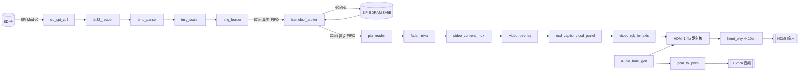

# 智播校园 SmartCampusMedia

[](LICENSE)

基于安路（Anlogic）**EG4S20** FPGA 的校园多媒体信息发布与应急提示终端。

整条链路——SD 卡读写、FAT32 解析、BMP 解码、帧缓存、播放控制、HDMI 视频与音频输出——**全部由 FPGA 逻辑实现**：没有外接处理器，没有 CPU 软核，没有跑任何一行软件。

面向全国大学生嵌入式芯片与系统设计竞赛 2026 FPGA 创新设计赛道，选题一：基于安路 EG4S20 的 HDMI 多媒体播放系统。

> **读哪一篇？**
> 本文 = *它是什么、怎么用、怎么复现、做到哪一步*。
> 想知道*为什么这么设计*（分层、数据流、时钟与跨域、存储器布局、仲裁、可观测性、取舍）→ [架构分析](ARCHITECTURE.md)。
> 想知道*还剩什么没做* → [任务总览](TASKS.md)。
> 想知道*测试到底覆盖了什么* → [测试覆盖](TEST_COVERAGE.md)。
> 想知道*哪一天改了什么、踩了什么坑* → [开发进度](docs/progress.md)。
> 全部文档索引见 [docs/README.md](docs/README.md)。

---

## 一、这是什么

一块板子、一颗 FPGA、一张 SD 卡、一根 HDMI 线。上电后自动扫描卡里的 `IMGnnn.BMP`，按 5 秒间隔轮播，同时输出 HDMI 画面与音频；16 个按键可以随时干预。

| 能力 | 实现方式 | 状态 |
|---|---|---|
| 静态图片播放 | SD→FAT32→BMP→SDRAM 帧缓存→HDMI | ✅ 已上板 |
| 自动轮播 | `player_ctrl` 5 秒计时 + 双缓冲无缝换帧 | ✅ 已上板 |
| 手动切图 | KEY0/KEY1，淡出到黑 → 换帧 → 淡入（约 286 ms） | ✅ 已上板 |
| 图片缩放 | `img_scaler` 只缩不放，小图 1:1 居中 + letterbox 遮蔽 | ✅ 仿真 + 综合布线 |
| 应急提示 | KEY15/KEY3 直达全屏红底告警 | ✅ 已上板 |
| 科普教学页 | 独立 640×480 RTL 页面（FPGA 与数字逻辑入门） | ✅ 已上板 |
| OSD 字幕 | 标题 / 图号 / 播放状态 / 64 字符滚动标语 | ✅ 仿真 + 综合布线 |
| HDMI 音频 | 48 kHz / 24 bit PCM 嵌入数据岛 + 3.5 mm PWM 双路 | ✅ 已上板 |
| 参数面板 | 亮度五档 / 反色 / 倍率 ×1~×4 实时调节 | ✅ 已上板 |
| 画面诊断 | 信息条、九宫格、音频电平柱与波形 | ✅ 已上板 |

**关键约束**（它们直接决定了架构，不是随意取舍）：

- **没有 CPU** —— 所有流程都是硬件状态机，没有中断、没有调度器、没有"等软件想起来"这回事。
- **帧缓存只能放在 SiP SDRAM** —— 一帧 640×480 RGB565 = 600 KiB，EG4S20 片内 EBR 远不够，板上也没有外挂显存。
- **SD 卡只有一条物理 SPI 总线** —— 探针、图库扫描、图片装载三件事必须严格串行。
- **多时钟源** —— 视频 25 MHz、TMDS 串化 125 MHz、SDRAM 40 MHz，三域之间只能走异步 FIFO。

---

## 二、当前状态（截至 2026-10-31）

**一句话**：正式顶层已经在板上稳定出图、显示卡内图片并可自动轮播；时序在 40 MHz 下全组收敛且余量可解释。转场、字幕、参数面板、缩放与看门狗这几项目前只有**仿真 + 综合布线**证据，最新一版合入了装载看门狗与启动交接加固，等待上板复验。

### 位流

位流体积 **629,640 B**，不随 Git 发布（`ip/local/` 下的官方加密核亦需自备），新环境请按[第七节](#七开发与复现)重建。

| 版本 | 本地位流 | 生成时间 | 时序 | 状态 |
|---|---|---|---|---|
| **最新候选：看门狗与启动交接加固版** | [smartcampus_media_watchdog_20261030.bit](reports/watchdog_20261030/) | 2026-10-30 22:50 | setup **+1.935 ns** / hold **+0.003 ns** | 综合、布线、bitgen 与七套回归全过；**尚未上板** |
| 烧录候选：图片防护版 | [smartcampus_media_20261030.bit](reports/flashable_20261030/) | 2026-10-30 15:39 | setup **+1.935 ns** / hold **+0.011 ns** | [验证报告](reports/flashable_20261030/verification.md) 完整；**尚未上板** |
| 已烧录：显示选择与科普页版 | [hdmi_noise_sci_fix.bit](reports/noise_sci_fix_20261029/) | 2026-10-29 20:51 | setup +1.935 / hold +0.003 | 已上板；切图白条问题当时仍复现，后于 10-30 定位根因 |
| HDMI 低音量试听版 | [hdmi_audio_quiet.bit](reports/hdmi_audio_quiet_20261029/) | 2026-10-29 17:17 | setup +1.935 / hold +0.003 | 已烧录；音量是否合适**待试听确认** |
| 显示修复版 | [hdmi_display_fix.bit](reports/display_fix_20261029/) | 2026-10-29 08:14 | setup +1.935 / hold +0.035 | 已上板，**用户确认深色区白条问题解决** |

> ⚠️ **两条 2026-10-30 的位流都还没有在实体板卡上跑过。** 烧录后请按[上板验证手册](docs/board_verification_2026-10-27.md)的重点项复验：启动出图、KEY0/KEY1 连按切图无竖向白条、自动轮播、KEY3 科普页、KEY15 应急页、音频、异常 BMP 恢复。仿真全帧对比不能代替板级检查。

### 硬指标

| 指标 | 数值 | 来源 |
|---|---|---|
| 时序（40 MHz，最终） | setup WNS **+1.935 ns**、hold WNS **+0.003 ns**、TNS 0、**0 个违例端点**（10,512 端点 / 578,116 路径） | `reports/watchdog_20261030/timing.txt` |
| 资源 | LUT **15,088 / 19,600（76.98%）**、BRAM9K 17/64、DSP 19/29、PLL 2/4、GCLK 4/16、IO 41/188 | `reports/watchdog_20261030/area.txt` |
| STA 覆盖率 | 99.89%（未覆盖部分为外部 IO 延迟与 PLL 反馈） | `reports/watchdog_20261030/coverage.txt` |
| 自动回归 | **七套全过、848,063 条断言、约 25 分钟**（2026-10-31 实跑） | [TEST_COVERAGE.md](TEST_COVERAGE.md) |
| lint | 103 个源文件，E0/E1/E2 阻断项 **全 0** | `scripts/lint_verilog.py` |
| 视频 | 640×480 @ 59.52 Hz，像素时钟 25 MHz | `video_timing_gen` |
| 音频 | 48 kHz / 24 bit PCM；HDMI 侧右移 6 位（**1/64 ≈ −36.12 dB**） | `audio_tone_gen` / 顶层 `HDMI_AUDIO_ATTEN_SHIFT` |

### 最近三天解决了什么

| 日期 | 问题 | 根因 | 处理 |
|---|---|---|---|
| 10-30 晚 | 上电后数码管稳定显示 **`d810`**、屏幕永不出图 | ① 播放器 `sd_ready` 接成电平 `sd_ok`，图库扫描还没结束就抢总线，单拍 `blk_start` 被仲裁选走 → 请求**直接丢弃**；② `img_loader`/`fat32_reader` 只等握手、无超时也不重发 → 永久挂死；③ 上层 4 秒超时是唯一兜底 | `sd_ready` 改接 `sd_owner_player`；`image_player` 增加 `pending` 请求锁存，跨所有权交接不丢脉冲；新增 `tb_startup_ownership`（9 条检查）固化该场景 |
| 10-30 晚 | 慢卡整帧装载被误判成超时 | 看门狗是"整帧固定 4 秒"上限，与卡速耦合 | 改为**按进度计时**：每完成一个扇区就喂狗，`LOAD_TIMEOUT` 变成"单扇区无进度"上限；超时按阶段细分为 `d8`/`dB`/`dC` |
| 10-30 | 零尺寸图片导致边界行为未定义 | 缩放器商寄存器位宽不足（`HDL-8007`），`img_scaler` 一度被当成黑盒 | 商寄存器全改 `[DIV_BITS-1:0]`；`bmp_parser` 增加 `CHECK_SIZE`；`tb_image_player` 覆盖 0×0 边界 |
| 10-30 | C2 图片缩放需求 | — | 新增 `img_scaler`（Bresenham 只缩不放）+ `image_window_mask`（letterbox 置黑）；**目标宽必须 8 像素对齐** |
| 10-29 晚 | 换图瞬间竖向白条 | 显示优先级把"有没有图"与"这一拍像素是否有效"压进一个三目，欠载拍漏出 `pattern_sel=0` 的纯白彩条 | `video_content_mux` 新增 `image_ever_ready`：有图期间欠载显示黑，测试图只作"从未有过素材"的兜底 |
| 10-29 | 深色区周期白条、偶发花屏 | ① 读组首间隔 12 拍 < 真实核需要的 13 拍；② 刷新宏缺括号算出 −10 拍；③ 核内自动刷新与手动刷新交叠产生 25 ns 双 AREF | 12→13 拍；宏补括号；关核内自动刷新 + 排空 + 静默 16 拍 + 手动单拍刷新 + 1024 拍看门狗 |

> 更早的过程（150 MHz → 100 MHz → 40 MHz 的降频推导、"为什么不能靠拆时钟组骗过工具"）见 [ARCHITECTURE.md §8](ARCHITECTURE.md) 与 [开发进度](docs/progress.md)。

---

## 三、硬件与工具链

| 项 | 型号 / 版本 |
|---|---|
| 器件 | 安路 EG4S20BG256（19,600 LUT / 64 BRAM9K / 29 DSP / 4 PLL / 188 IO） |
| 帧缓存 | 片内 SiP SDRAM `EG_PHY_SDRAM_2M_32`，2M×32 bit = 8 MiB，无外部引脚 |
| 晶振 | 板载 50 MHz（球 R7） |
| 视频输出 | HDMI（4 对 TMDS：CLK/D0/D1/D2），**板上未引出 DDC，不做 EDID 协商** |
| 存储 | microSD（SPI 模式）、M25P16 SPI Flash（未使用写通道） |
| 音频 | HDMI 内嵌 + 3.5 mm PWM 输出；另有 ADC 输入与触摸屏接口（未启用） |
| EDA | 安路 TD **v6.2.168116**（默认 `D:/TD_6_24_APP`） |
| 仿真 | ModelSim ASE 10.1d（默认 `D:/Quartus_APP/modelsim_ase/win32aloem`）；可选 Questa 2022.1 |
| 脚本 | Python 3、PowerShell 5.1 |

### 板级引脚

| 功能 | 信号 | 球号 | 说明 |
|---|---|---|---|
| 时钟 | `clk` | R7 | 50 MHz 有源晶振 |
| 复位 | `rst_n_btn` | E3 | 按键，低有效 |
| 键盘行 | `key_row[3:0]` | E10, C10, F9, D9 | 低电平扫描选通 |
| 键盘列 | `key_col[3:0]` | E11, D11, C11, F10 | 上拉，按下为低 |
| LED | `led[7:0]` | B14, B15, B16, C15, C16, E13, E16, F16 | 高电平点亮 |
| 数码管段 | `seg_data[7:0]` | A4, A6, B8, E8, A7, B5, A8, C8 | 低有效 |
| 数码管位 | `seg_cs[3:0]` | C9, B6, A5, A3 | 低有效 |
| SD 卡 | `sd_cs_n` / `sd_sck` / `sd_mosi` / `sd_miso` / `sd_cd` | F13 / F15 / F14 / D14 / E15 | `sd_cd` 无卡时为 1 |
| HDMI | `HDMI_CLK_P` / `HDMI_D0_P` / `HDMI_D1_P` / `HDMI_D2_P` | P1 / N1 / P4 / J3 | LVDS33 |
| 音频 | `audio_pwm` | F3 | 3.5 mm 耳机座 |
| 蜂鸣器 | `buzzer` | H11 | 低电平鸣响 |

> 引脚有三份来源（引脚说明 PDF、厂商例程 `pin.adc`、底板原理图），本项目以**引脚说明**为准；两处已知冲突（键盘行序、SD MOSI/MISO）仍需实测核定，见[上板验证手册](docs/board_verification_2026-10-27.md)。

---

## 四、系统架构



**一条完整的数据流**（写路径 / 读路径分离，靠双缓冲解耦）：

`SD 卡 → sd_spi_ctrl → fat32_reader → bmp_parser → img_scaler → img_loader → framebuf_arbiter → SDRAM`
`SDRAM → framebuf_arbiter → pix_reader → fade_mixer → video_content_mux → video_overlay → osd → HDMI`

### 四条关键设计

1. **双缓冲 + 垂直消隐换帧**：写入后台帧，完整像素数到位才提交，`commit_pending` 等下一次垂直消隐上升沿才翻 `front_sel`，切换落在消隐区不撕裂。8 MiB 可放 13 帧，实际只用前 2 帧。
2. **转场用"淡出到黑"而非交叉溶解**：交叉溶解需要两路并发读（27.4 M 字/s，占 40 MHz 带宽的 68%），且要复制 reader 与双读口仲裁器，会作废单读通路已验的全部证据。淡出方案只需一路读，`fade_mixer` 是纯组合的 237 LUT + 2 DSP + 0 寄存器。
3. **单 SD 口三段严格串行**：探针 → 图库扫描 → 图片装载，用"上一段是否已完成"（`gallery_done || gallery_fail`）而不是电平 `sd_ok` 做判据。这是 `d810` 的教训：电平判据会让播放器在图库扫描期间抢到总线并把请求丢掉。
4. **跨域一律走异步 FIFO**：写 57 bit（字地址 + 字节掩码 + 数据），读 32 bit；单 bit 状态用两级同步器，事件用翻转位握手，多 bit 计数用 Gray 码。音频不设独立时钟域——HDMI 1.4b 核的 EDID/Video/Audio/ACR 四个接口全部工作在像素时钟域。

细节（五层分层、四字组与刷新时序、单口仲裁、可观测性、模块接口契约速查）见 [ARCHITECTURE.md](ARCHITECTURE.md)。

---

## 五、操作与诊断

### SD 卡怎么准备

把 `IMG001.BMP`、`IMG002.BMP`……（三位数字、从 001 开始、连续编号）放在**卡根目录**，格式化为 **FAT32**。图片规格：

- 640×480、24 bit 未压缩 BMP（`biCompression = 0`）；
- 尺寸不是 640×480 的图会被 `img_scaler` 等比缩小后居中显示（宽必须能被 8 整除才对齐），不是 640×480 也**不再直接报错**；
- 33 MB 以上的卡用 SDHC（CMD17 单块读，512 B/块）。

仓库自带两张测试图（`assets/sd_images/`）：`IMG001.BMP` 彩条、`IMG002.BMP` 白底中央 200×200 红块。也可以用脚本生成整套上板验证素材：

```powershell
powershell -ExecutionPolicy Bypass -File scripts\prepare_board_verify_assets.ps1
```

产出 `assets/sd_verify/{good,bad_size,bad_bmp,empty}/` 四套，分别验证"正常图库 / 宽高不符 / 签名损坏 / 零张图"。

### 16 键

| 键 | 功能 | 键 | 功能 |
|---|---|---|---|
| KEY0 | 上一张 | KEY8 | 反色开关 |
| KEY1 | 下一张 | KEY9 | 显示倍率 ×1~×4 |
| KEY2 | 自动轮播开关 | KEY10 | 重新扫描图库 |
| KEY3 | 日常 / 科普 / 应急 三态切换 | KEY11 | 九宫格参考线 |
| KEY4 | 上一个测试图案 | KEY12 | 信息条 |
| KEY5 | 下一个测试图案 | KEY13 | 音频图层（关/电平/波形/两者） |
| KEY6 | 静音（HDMI + 3.5 mm 同时） | KEY14 | 蜂鸣器静音 |
| KEY7 | 亮度五档 | KEY15 | 应急模式直达（再按退出） |

### LED 与数码管

**LED[7:0]**（高有效）

| LED | 含义 | LED | 含义 |
|---|---|---|---|
| LED7 | 当前有面向用户的错误 | LED3 | 应急模式 |
| LED6 | 图片装载中 | LED2 | 读 FIFO 异常 |
| LED5 | SDRAM PLL 锁定 | LED1 | 自动轮播开启 |
| LED4 | HDMI PLL 锁定且核视频锁定 | LED0 | 图片就绪（`image_ready`） |

**数码管 DIG3~DIG0** = `[错误类别 | 播放状态] [子码 | 内部错误码] [当前图号低 4 位] [测试图案序号]`

`d810` 就是一次真实读数：类别 `d`（数据通路）、子码 `8`（装载无进度）、图号 1、测试图案 0。

出错时两位换成"助记字母 + 类内子码"，用五类**用户动作**替代原先跨五个模块的 1~9 内部码：

| 显示 | 含义 | 用户该做什么 |
|---|---|---|
| `C0` | 卡座报告无卡 | 插卡 |
| `C1` / `C2` / `C9` | CMD0 重试耗尽 / CMD8·CMD55 异常 / ACMD41·CMD58 异常 | 换卡或检查接触 |
| `F1` ~ `F4` | MBR 签名错 / 分区表异常 / 不是 FAT32 / 找不到图 | 重新格式化为 FAT32 |
| `00` | 卡读通了，但根目录没有一张 `IMGnnn.BMP` | 往卡里放图 |
| `b1` / `b2` / `b9` | BMP 头非法 / 宽高不是 640×480 / 其他 BMP 错误 | 换一张合规的图 |
| `d1` ~ `d7` | SD 内部失败 / 读块失败 / 簇链异常 / FIFO 无空间 / SDRAM 仲裁或不在线 | 多为数据通路问题，先复位 |
| `d8` | 装载无进度（看门狗超时） | 卡太慢或总线异常，换卡试 |
| `dA` | 等 `blk_done` 握手超时（`img_loader` 84 ms 超时） | 控制器无响应，复位 |
| `dB` / `dC` | 等 SDRAM 初始化超时 / 等写完成超时 | 复位；反复出现说明 SDRAM 侧有故障 |
| `d9` | 未归类的数据通路故障 | — |

出错后约 **1.5 秒静默观察期**（先让你看见数码管），再鸣响 3 秒。

---

## 六、仓库结构

```
SmartCampusMedia/
├── rtl/                     自研 RTL，53 个文件（唯一真源）
│   ├── top/                 顶层装配（hdmi / bringup / min 三个顶层）
│   ├── storage/             SD、FAT32、BMP、缩放、帧缓存、仲裁、SDRAM 包装
│   ├── video/               时序发生器、内容选择、叠加、科普页（+ hdmi/ 子目录）
│   ├── osd/                 字库、字幕、参数面板、自动弹出
│   ├── control/ input/ display/ audio/ common/
├── constraints/             SDC 时序约束（唯一真源）
├── project/                 TD 工程 .al、构建 tcl、自动生成的源码副本
├── sim/                     62 个 testbench + 20 个回归脚本 + 官方仿真库说明
├── scripts/                 lint、同步、位图生成、字幕预览校验等 20 个工具
├── assets/                  SD 测试图、上板验证素材、校园素材生成脚本
├── reports/                 54 个带日期的构建与仿真证据目录
├── docs/                    32 篇专题文档（索引见 docs/README.md）
├── ip/                      config/ 为受版本控制的 SDRAM 宏；local/ 需自备
└── ip/local/ ip/reference/  官方加密 IP 与例程（不随仓库发布）
```

> **只有 `rtl/` 和 `constraints/` 是代码真源。** `project/src`、`project/hdmi` 下是 `scripts/sync_src.ps1` 生成的副本，手改会在下次同步时被覆盖。

---

## 七、开发与复现

### 1. 环境准备

```powershell
# 官方 IP 不随仓库发布，需从安路渠道获取后放到：
#   ip/local/sdram/      （加密 SDRAM 核与引脚模型）
#   ip/local/hdmi/enc/   （hdmi_1_4b_transmitter_core）
# 仿真还需要官方仿真库（默认 D:\TD_6_24_APP\sim_release\eg4\）
```

### 2. 同步源码副本 + 静态检查（每次改完 RTL 必做）

```powershell
powershell -ExecutionPolicy Bypass -File scripts\sync_src.ps1
python scripts\lint_verilog.py rtl project\src project\hdmi
```

lint 会拦三类**必须为 0**的阻断项：**E0** 文件编码损坏、**E1** 同一 always 块里阻塞与非阻塞混用、**E2** 同一信号被多个 always 块驱动。

### 3. 跑回归（七套）

```powershell
# 全量（约 25 分钟）
powershell -ExecutionPolicy Bypass -File sim\scripts\run_full_regression.ps1

# 单套
powershell -ExecutionPolicy Bypass -File sim\scripts\run_frontend_regression.ps1   # 前端 20 用例
powershell -ExecutionPolicy Bypass -File sim\scripts\run_storage_regression.ps1 -Suite All -FullVga
powershell -ExecutionPolicy Bypass -File sim\scripts\run_image_regression.ps1 -FullVga
powershell -ExecutionPolicy Bypass -File sim\scripts\run_audio_regression.ps1
powershell -ExecutionPolicy Bypass -File sim\scripts\run_startup_ownership_regression.ps1
powershell -ExecutionPolicy Bypass -File sim\scripts\run_unit_coverage_regression.ps1
powershell -ExecutionPolicy Bypass -File sim\scripts\run_display_content.ps1
```

**怎么算通过**（四条同时满足，不是只看退出码）：

1. 退出码为 0；
2. 日志含 `ALL CHECKS PASSED: <top>` 标记；
3. `PASS:` 行数大于 0；
4. 日志不含 `CHECKS FAILED` / `GLOBAL TIMEOUT` / `FAIL:` / `** Error`。

### 4. 综合、布局布线、生成位流

```powershell
& D:/TD_6_24_APP/bin/td_commands_prompt.exe ./project/flow_watchdog_20261030.tcl
```

脚本会依次打印 `FLASHABLE_BUILD_PASS-<step>`，最后解析 `timing.txt` 校验 setup/hold 松弛量；任一步失败或出现负松弛即 `exit 2/3`，**不会产出位流**。位流与 `timing.txt` / `area.txt` / `coverage.txt` 落在 `reports/<日期>/`。

> ⚠️ TD 脚本里**不要用** `[file join]` 拼路径再交给 `open_project`——`cd` 之后会报 `PRJ-8601`。用 `$prjdir/name` 显式正斜杠。

### 5. 常见坑

| 现象 | 原因 | 处理 |
|---|---|---|
| 数码管 `d810`，屏幕不出图 | 播放器抢了图库的 SD 总线，请求被丢弃 | 已修；确认 `sd_ready` 接的是 `sd_owner_player` |
| 切图瞬间竖向白条 | 显示优先级在欠载拍回落到 `pattern_sel=0`（纯白彩条） | 已修；确认 `video_content_mux` 接了 `image_ever_ready` |
| 慢卡被误判超时 | 看门狗按整帧计时 | 已修；看门狗改按扇区进度喂狗 |
| ModelSim `vlog` 挂死、只打印 `in protected region` | 加密 HDMI 核在 ASE 10.1d 下无法仿真 | 整链仿真的替代方案见 [TEST_COVERAGE.md §4.4](TEST_COVERAGE.md) |
| `unexpected non-printable character 0xef` | 用 `Set-Content -Encoding utf8` 写出了 BOM | `.v` 必须无 BOM，见 [贡献指南](CONTRIBUTING.md) |

---

## 八、验证与证据

**三档口径**——这三档不能互相替代，任何结论都要说明它落在哪一档：

| 档 | 证明什么 | 不能证明什么 |
|---|---|---|
| 行为仿真 | 逻辑功能与边界条件正确 | 真实加密 IP 的行为、时序是否收敛 |
| 综合 + 布线 + STA | 资源放得下、时序在工具模型下收敛 | 上板一定正常（IO 延迟约束不完整） |
| 上板 | 真实硬件上的输出正确 | 长时间无偶发失效（需压测） |

主要证据目录：

| 证据 | 位置 |
|---|---|
| 烧录候选完整验证记录（51 个源文件 SHA-256 + 全套回归） | [`reports/flashable_20261030/verification.md`](reports/flashable_20261030/verification.md) |
| 最新构建的时序 / 面积 / 覆盖率报告 | `reports/watchdog_20261030/{timing,area,coverage}.txt` |
| 七套回归的逐条结果（JSON） | `reports/local_check/` |
| 噪点根因分析（含诊断决策树） | [`docs/noise_root_cause_2026-10-30.md`](docs/noise_root_cause_2026-10-30.md) |
| 显示异常的三个根因 | [`docs/display_fix_2026-10-29.md`](docs/display_fix_2026-10-29.md) |
| 上板验收清单（6 阶段 + 2 项核定） | [`docs/board_verification_2026-10-27.md`](docs/board_verification_2026-10-27.md) |

**为什么最后必须降到 40 MHz**：读 DQ 的松弛量满足 `slack = T/2 − 10.565 ns`，写 DQ 满足 `slack = T/2 − 7.001 ns`。那个 10.565 ns 是 SiP 硬核模型的固定惩罚（5.000）+ 布线偏斜 + 封装延迟，且 `Data Path Delay 6.453 ns` 在 150/100/40 MHz 下**完全一样**——不存在靠调工具或加约束"优化"掉的余地。反算临界频率：读 ≤ 47.33 MHz、写 ≤ 71.42 MHz，所以 40 MHz 是唯一能同时满足两组、又留出可解释余量的选择。带宽仍是需求的 2.9 倍。

> 曾试过的三段捷径都失败了：拆分时钟组只是把接口数字挪出了检查范围（BUFG 并不改变时序数字）；`phys_opt -post_place` 反而更差（0.275 → 0.178 ns）；`phys_opt -post_route` 在 TD v6.2.168116 直接崩溃（`0xC0000005`）。

**遗留告警**（时序已通过，告警仍会打印）：`USR-6135`×2（PLL 反馈走 local network）、`SYN-5013`×2（加密核内部信号未驱动）、`SYN-5011`（BRAM 未用端口）、`SYN-6562`×3（`eram_init` 关闭）、`HDL-5007`（`fat32_reader.v` 中常量被截断为 9 bit，值在范围内）、`PHY-7002`×2（SiP 位置约束）。

---

## 九、已知限制与后续

**功能缺口**

- 只支持无压缩 24 bit BMP；PNG/JPEG、视频解码均未实现。
- OSD 字库是 8×16 ASCII **41 字形**（数字、大写字母、少量符号），**不含汉字与小写字母**；中文 OSD 需要 16×16 点阵（约 40 LUT/字）。
- 缩放只缩不放；目标宽度须能被 8 整除。
- 参数（亮度/反色/倍率）只在会话内保持，掉电恢复默认（SD 卡只有读通道，未实现 SPI Flash 写入）。
- 音频是状态音调，不是音频文件播放；电平柱与波形有，**没有 FFT**。
- SD 热插拔无自动恢复（可用 KEY10 重扫替代）；拨码开关与 ES8388 同球互斥，未实施。

**优先级最高的待办**

| 优先级 | 事项 |
|---|---|
| P0 | 烧录 `watchdog_20261030` 位流，逐项复验启动出图、KEY0/KEY1 连按、轮播、科普页、应急页、音频、异常 BMP 恢复 |
| P0 | 核定键盘行序与 SD MOSI/MISO 两处引脚来源冲突 |
| P0 | 用示波器实测 SDRAM_CLK 与 DQ 的相对关系，确认 TD 的 ±5.000 ns 硬核模型是否可信 |
| P1 | 长时压测 ≥ 2 小时 + 反复复位 + 断电重启；SDRAM 读路径持续压力 |
| P1 | 异常注入（坏 BMP、超大簇链、拔卡瞬间）与 KEY7~KEY14 逐键板上确认 |
| P2 | 汉字字幕（16×16 点阵）、参数持久化 |
| P2 | 上板复验 B2 转场与 C2 缩放的真实观感 |

---

## 十、参与贡献

欢迎 issue 与 pull request。动代码前请读 [贡献指南](CONTRIBUTING.md)：编码规范、`sync_src.ps1` 同步流程、lint 门槛，以及提交证据时**必须避免的三类过度宣称**——未跑的仿真、行为模型当真实 IP、功能通过当时序收敛。

提交信息用 Conventional Commits（`feat:` / `fix:` / `docs:` / `refactor:` / `test:` / `chore:`），一次提交聚焦一件事。

## 许可证

本仓库中自研的 RTL、脚本与文档以 [MIT License](LICENSE) 发布，可自由使用、修改、分发与商用，保留版权与许可声明即可。

**不在 MIT 许可范围内**：

- `ip/local/`、`ip/reference/`、`project/reference/` 下的官方参考设计、加密 IP 与器件模型，版权归安路科技及相关权利人所有。这些文件不随本仓库发布，使用者须自行从合法渠道获取并遵守其原始许可。
- 官方文档（APUG010/011/092、IPUG012 等）的引用仅用于说明设计依据，不构成对其内容的再许可。

若要在自己的项目中复用，建议只以 `rtl/` 下自研模块为起点，并自行确认所依赖 IP 的授权状态。

## 来源与声明

自研模块与官方移植模块按源码注释区分。官方例程、加密 IP、器件模型与资料的版权归各自权利人所有，本仓库不发布这些文件，也不对它们赋予额外许可。

字体点阵与素材来源见 [`docs/science_font_attribution.md`](docs/science_font_attribution.md) 与 [`docs/OFL-NotoSansSC.txt`](docs/OFL-NotoSansSC.txt)。

**应急模式仅用于项目演示，本系统未取得公共安全或消防设备认证。**
