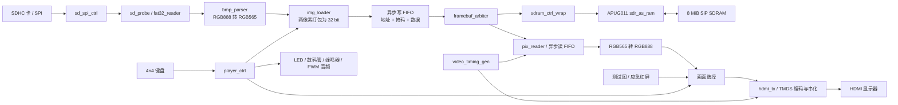

# 智播校园 SmartCampusMedia

[](LICENSE)

基于安路 EG4S20 FPGA 的校园多媒体信息发布与应急提示终端，用于校园大厅、教学楼和实验室的信息展示。SD 卡读取、文件解析、帧缓存、播放控制和视频输出均由 FPGA 实现，无外接处理器。

项目面向全国大学生嵌入式芯片与系统设计竞赛 2026 FPGA 创新设计赛道，选题一：基于安路 EG4S20 的 HDMI 多媒体播放系统。

## 当前实现与验证状态

**截至 2026-10-20，SD → FAT32 → BMP → SDRAM → HDMI 图片通路已完成集成，并在 DMZ-EG4S20 板卡上显示出白底中央红块。** 应急红屏与间歇蜂鸣也已实测。日常、科普、应急三种模式已有控制入口，日常与科普目前共用同一图库。

本次上板确认对应独立诊断工程 `image_dm_fix`：数码管 **7777**、**LED0～5 亮、LED6/7 灭**、中央红块出现，整帧读回比较通过。该灯码属于诊断工程，不适用于正式顶层。

**功能通过尚不代表时序验收完成。** 该诊断版本布线后的 SiP SDRAM 接口整体 setup WNS 为 **−7.232 ns**，hold WNS 为 **+0.030 ns**；长期稳定性与完整产品功能仍待验收。详见 [DQM 修复与上板证据](docs/image_dm_fix_2026-10-20.md)。

## 硬件与工具链

| 项目 | 配置 |
|---|---|
| 核心板 | 大拇指 DMZ-EG4S20，FPGA 为 EG4S20BG256 |
| 底板 | MO 综合底板：HDMI、SD 卡槽、4×4 键盘、数码管、LED、蜂鸣器及 PWM 音频 |
| 输入时钟 | 50 MHz |
| 帧存储 | 芯片内置 SiP SDRAM，2M×32 bit，共 8 MiB |
| 视频输出 | 640×480，约 60 Hz，DVI 兼容 TMDS，经 HDMI 接口输出 |
| 开发工具 | 安路 TD、ModelSim；Python 3 与 Windows PowerShell 用于工程脚本 |

管脚与来源见 [板级确认清单](docs/pending_confirmations.md) 和 [HDMI 管脚约束](constraints/dmz_eg4s20_hdmi.adc)。仓库原工具基线为 TD 6.2.1；本机后续构建使用 `D:/TD_6_24_APP` 中的工具，复现时请核对安装路径及版本。

## 系统架构

顶层入口为 [`dmz_eg4s20_hdmi_top.v`](rtl/top/dmz_eg4s20_hdmi_top.v)。系统分为资源读取、帧存储、视频输出和交互控制四部分，`image_player` 负责图片通路的装载与提交。



SDRAM 读取响应经封装层和仲裁器返回 `pix_reader`，图中的存储链路同时承载写入和读回。上电时先由 `sd_probe` 完成卡初始化及卷探测，再将扇区服务交给图片装载链路。

### 模块职责

| 模块 | 职责 |
|---|---|
| [`sd_spi_ctrl`](rtl/storage/sd_spi_ctrl.v) | SDHC 初始化、SPI Mode 0、CMD17 单扇区读取 |
| [`sd_probe`](rtl/storage/sd_probe.v) | 卡与 FAT32 卷的初始探测、状态反馈 |
| [`fat32_reader`](rtl/storage/fat32_reader.v) | 分区/卷解析、根目录短文件名查找、FAT 簇链读取 |
| [`bmp_parser`](rtl/storage/bmp_parser.v) | BMP 头检查、BGR 顺序与行方向处理、RGB565 转换 |
| [`img_loader`](rtl/storage/img_loader.v) | 文件读取与解析调度、像素打包、帧地址生成 |
| [`image_player`](rtl/storage/image_player.v) | 装载状态机、单帧提交、数据通路复位与错误回落 |
| [`framebuf_arbiter`](rtl/storage/framebuf_arbiter.v) | 协调帧写入与显示读取，处理刷新和分组边界 |
| [`sdram_ctrl_wrap`](rtl/storage/sdram_ctrl_wrap.v) | 封装官方 SDRAM 控制核，并提供行为仿真模型 |
| [`pix_reader`](rtl/storage/pix_reader.v) | SDRAM 预取、跨时钟像素 FIFO、逐像素输出 |
| [`video_timing_gen`](rtl/video/video_timing_gen.v) | 行场时序、有效显示区与像素坐标 |
| [`hdmi_tx`](rtl/video/hdmi/hdmi_tx.vhd) | 对接官方 TMDS 编码与串行输出 IP |
| [`player_ctrl`](rtl/control/player_ctrl.v) | 图片索引、手动切换、自动轮播与模式切换 |

### 帧缓存与提交机制

一帧包含 **307,200 个像素**。RGB565 每像素 16 bit，两像素组成一个 32 bit 存储字，因此一帧占 **153,600 字 / 614,400 字节 / 600 KiB**。

当前采用**单帧缓冲**。收到装载请求后，系统复位图片数据通路，等待存储器初始化，读取并写入整帧，待写 FIFO 排空后才提交画面。重载和失败期间显示测试图；尚未实现双缓冲无缝切换。

异步写 FIFO 为 57 bit，保存地址、字节掩码和数据，避免地址与数据跨域后错配。显示端通过预取 FIFO 将 SDRAM 的突发返回转换为连续像素流。

本次纯白故障的修复位于仲裁器：SDRAM 的 DQM 同时影响读和写。真实写入使用请求掩码，分组补写使用 `4'hF`，**读取与空闲时使用 `4'h0`**，防止正常读响应被掩码屏蔽。

### 时钟、复位与跨域

| 时钟域 | 频率 | 使用模块 |
|---|---|---|
| 板载参考时钟 | 50 MHz | PLL 输入与启动复位 |
| 视频 PLL 像素时钟 | 25 MHz | SD、文件解析、播放控制、像素时序 |
| 视频 PLL 串化时钟 | 125 MHz | HDMI 串行输出 |
| SDRAM PLL 内部时钟 | 150 MHz，0° | 仲裁器与 SDRAM 控制核 |
| SDRAM PLL 接口时钟 | 150 MHz，180° | SiP SDRAM 接口 |

视频与存储使用独立 PLL。跨域数据通过 Gray 码指针异步 FIFO 传递，状态使用同步器或 Gray 码计数处理，复位释放与 PLL 锁定状态关联。**SDRAM 的 0°/180° 时钟具有确定相位关系，必须保留相关时序分析。**

25 MHz 像素时钟、800×525 总时序对应约 **59.52 Hz**。SD 初始化 SCK 约 **390.6 kHz**，正常读取 SCK 为 **12.5 MHz**。

## SD 卡素材与按键

支持 **SDHC、FAT32**，包括 MBR 分区卷和从 LBA0 开始的无分区卷。当前不支持 SDSC、exFAT、长文件名或目录递归。

- 素材放在根目录，以 `IMG001.BMP`、`IMG002.BMP` 等连续短文件名命名。
- 图片必须为 **640×480、24 bit、无压缩 BMP**；显示时转换为 RGB565。
- 顶层参数 `GALLERY_COUNT` 默认是 **1**，可配置为 1～31；没有自动扫描图库。
- 当前没有 SD 热插拔恢复；插好卡后按复位键重新初始化。

生成仓库中的两张测试图：

```powershell
powershell -ExecutionPolicy Bypass -File scripts/make_test_bmps.ps1
```

[`IMG001.BMP`](assets/sd_images/IMG001.BMP) 是彩条，[`IMG002.BMP`](assets/sd_images/IMG002.BMP) 是白底中央 200×200 红块。**复现本次红块诊断时，应将仓库的 `IMG002.BMP` 复制到卡根目录并命名为 `IMG001.BMP`**。红块坐标为 x=220～419、y=140～339。

| 按键 | 当前行为 |
|---|---|
| KEY0 / KEY1 | 上一张 / 下一张；单张图库时重新装载同一张 |
| KEY2 | 切换自动轮播，默认间隔约 5 秒 |
| KEY3 | 日常 → 科普 → 应急 → 日常；可退出应急 |
| KEY15 | 应急直达：红屏并间歇蜂鸣，已上板确认 |
| KEY4 / KEY5 | 选择测试图，在装载、失败或像素未就绪时可见 |
| KEY6 | PWM 测试音静音切换，不控制应急蜂鸣器 |

## 仓库结构

```text
SmartCampusMedia/
├── rtl/
│   ├── top/          # 系统顶层与板级连接
│   ├── storage/      # SD / FAT32 / BMP / 帧缓存 / SDRAM / 诊断
│   ├── video/        # 视频时序、测试图、HDMI
│   ├── control/      # 播放控制状态机
│   ├── input/        # 矩阵键盘扫描与消抖
│   ├── display/      # 数码管扫描
│   ├── audio/        # 蜂鸣器与 PWM 测试音
│   └── common/       # 异步 FIFO、段码等公共模块
├── constraints/      # 管脚 ADC 与时序 SDC
├── project/          # TD 工程、源文件副本、构建 Tcl 与诊断工程
├── sim/              # testbench 与独立回归脚本
├── scripts/          # 源码同步、静态检查、工程生成与证据核对
├── assets/sd_images/ # 可直接用于 SD 卡的测试 BMP
├── reports/          # 精选仿真、时序、上板记录及扇区回放数据
├── docs/             # 架构、硬件依据、集成与故障定位记录
└── ip/local/         # 本地官方 IP，需自行准备，不随仓库发布
```

`rtl/` 是日常维护入口。`project/src/` 和 `project/hdmi/` 是 TD 使用的副本，通过同步脚本更新；诊断工程保存了独立的生成源码，便于核对已测版本。

## 开发与复现

以下命令均在仓库根目录运行，TD 流程另有说明。

### 1. 同步与静态检查

```powershell
powershell -ExecutionPolicy Bypass -File scripts/sync_src.ps1
python scripts/lint_verilog.py rtl project/src project/hdmi
```

同步脚本按映射增量复制并运行 lint；时序块用非阻塞赋值，组合块用阻塞赋值，禁止多驱动。请先同步，再用 TD 构建。

### 2. 行为仿真

安装 ModelSim 后执行；默认路径为 `D:/Quartus_APP/modelsim_ase/win32aloem`，可用各脚本的 `-ModelSimPath` 覆盖。下面将结果写入独立目录，保留历史上板证据。

```powershell
powershell -ExecutionPolicy Bypass -File sim/scripts/run_frontend_regression.ps1 -ReportDir reports/local_check/frontend
powershell -ExecutionPolicy Bypass -File sim/scripts/run_storage_regression.ps1 -FullVga -ReportDir reports/local_check/storage
powershell -ExecutionPolicy Bypass -File sim/scripts/run_image_regression.ps1 -FullVga -ReportDir reports/local_check/image
powershell -ExecutionPolicy Bypass -File sim/scripts/run_sd_card_replay.ps1 -ReportDir reports/local_check/card_replay
```

分别覆盖 SD 协议/FAT32/BMP/播放控制、FIFO/仲裁/存储模型/像素读取、完整 VGA 装载显示，以及真实 SD 卡扇区回放。脚本检查明确的通过标记，并记录源码哈希；仿真退出本身不能代表成功。

### 3. 官方 IP 与综合

全链综合和真实控制核仿真需要自行从合法官方资料准备以下文件：

- `ip/local/sdram/`：`global_def.v`、`sdr_wrrd.enc.v`、`sdr_init_ref.enc.v`、`sdr_as_ram.enc.v`；真实控制核仿真还需 `IS42s32200.v`。
- `ip/local/hdmi/enc/`：`DVITransmitter.enc.vhd`、`SerializerN_1_lvds.enc.vhd`、`SerializerN_1_lvds_dat.enc.vhd`、`TMDSEncoder.enc.vhd`，并同步至 `project/hdmi/enc/`。

这些官方文件及参考资料不在 Git 中。行为模型回归无需加密 IP；综合还依赖 TD 的器件库与原语支持。

正式图片工程为 [`project/hdmi_td.al`](project/hdmi_td.al)，顶层 `dmz_eg4s20_hdmi_top`。在 TD 中依次执行 Read Design、Optimize RTL、Optimize Gate、Place、Route、Generate Bitstream，或在本机 PowerShell 中运行：

```powershell
& D:/TD_6_24_APP/bin/td_commands_prompt.exe ./project/flow_s6_bit.tcl
```

脚本按自身位置推导工程与约束路径，不依赖调用时的当前目录。

请按实际安装位置调整工具路径。生成候选为 `project/hdmi_td_Runs/phy_1/hdmi_td.bit`；必须同时检查构建日志和布线后 timing 报告。脚本会在时序失败时返回失败，即使候选 bit 已生成。

### 4. 重建已上板的红块诊断工程

```powershell
python scripts/prepare_image_dm_fix.py
powershell -ExecutionPolicy Bypass -File sim/scripts/run_image_path_diag.ps1 -DmFix -FullVga
& D:/TD_6_24_APP/bin/td_commands_prompt.exe ./project/flow_image_dm_fix.tcl
python scripts/check_image_path_diag.py --dm-fix
```

生成器根据当前检出路径创建工程；重新构建会更新本地证据。历史 bit 不随仓库发布，构建后也不能假设哈希与历史文件一致。将卡内 `IMG001.BMP` 准备为白底红块，接好 HDMI，下载该诊断工程产生的 bit，复位并等待约 5 秒。历史验收结果为 **7777 / LED0～5 亮 / 中央红块出现**。

`check_image_path_diag.py` 依赖本地 bit、官方 IP 及相关仿真记录。它核对源码、bit 哈希和证据关联，不会将功能通过解释为时序通过；在全新克隆中须先准备依赖并生成相应结果。

## 验证证据与后续工作

| 验证项 | 已记录结果 | 证据入口 |
|---|---|---|
| DQM 仲裁回归 | 15 个场景、50,900 项检查通过 | [仲裁回归](reports/dm_mask_fix/arbiter/result.json) |
| 完整图片诊断仿真 | 边界 6,184 项，完整 VGA 614,406 项检查通过 | [诊断仿真](reports/image_dm_fix/simulation/result.json) |
| 真实加密 SDRAM 控制核功能仿真 | 修正后 614,406 项检查通过；保留原始失败对照 | [修正结果](reports/image_real_core_sim/idle_dm_fix/result.json) / [失败对照](reports/image_real_core_sim/small/result.json) |
| 直接读回比较单元 | 12 项检查通过 | [读回单元](reports/image_dm_fix/unit/result.json) |
| 板卡反馈 | 白底红块出现，整帧比较通过 | [上板记录](reports/image_dm_fix/board_feedback.json) |
| 静态时序 | SiP 接口 setup 未收敛 | [布线后报告](reports/image_dm_fix/timing.txt) |

真实控制核仿真使用功能性引脚模型设置，不能验证板级物理时序。各历史记录绑定其对应源码和构建版本，不能代替后续改动后的重新验证。

后续优先完成 SDRAM 时序收敛、反复复位与长时间运行测试，再验收多图切换和错误恢复。HDMI 音频嵌入、视频解码、OSD 字幕、缩放、转场和双缓冲目前尚未实现；当前音频只有 PWM 测试音与蜂鸣提示。

更多说明：[集成交接](docs/s6_integration_2026-10-20.md)、[存储架构设计](docs/phase4_architecture.md)、[开发进度](docs/progress.md)、[FAT32 2110 故障记录](docs/sd_card_2110_2026-10-20.md)、[项目定义](docs/project_definition.md)。

## 参与贡献

欢迎提交 issue 与 pull request。提交前请阅读 [贡献指南](CONTRIBUTING.md)：其中列明了编码规范、`sync_src.ps1` 同步流程、lint 要求，以及提交证据时必须避免的三类过度宣称（未跑的仿真、行为模型当真实 IP、功能通过当时序收敛）。

## 许可证

本仓库中由本项目自研的 RTL、脚本与文档以 [MIT License](LICENSE) 发布，可自由使用、修改、分发与商用，保留版权与许可声明即可。

**不在 MIT 许可范围内**的内容：

- `ip/local/`、`ip/reference/`、`project/reference/` 下的官方参考设计、加密 IP 与器件模型，版权归安路科技及相关权利人所有。这些文件不随本仓库发布，使用者须自行从合法渠道获取并遵守其原始许可。
- 官方文档（APUG010/011/092 等）的引用仅用于说明设计依据，不构成对其内容的再许可。

如果你在自己的项目中复用了本仓库的模块，建议仅以 `rtl/` 下自研模块为起点，并自行确认所依赖 IP 的授权状态。

## 来源与声明

自研模块与官方移植模块按源码注释区分。官方例程、加密 IP、器件模型和资料的版权归各自权利人所有，本仓库不发布这些文件，也不赋予它们额外许可。应急模式用于项目演示，系统尚未取得公共安全或消防设备认证。
