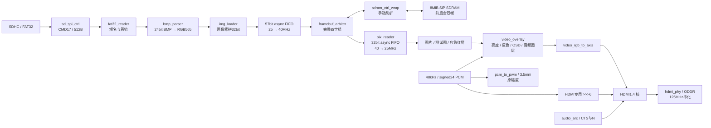

# 阶段四架构与当前生产实现：SD 卡图片播放系统

> 本文由 2026-10-17 的 v1 设计草案更新为 **2026-10-29 实现对照**。历史上提出的 CMD18、150 MHz、仅消隐期写帧、单缓冲起步和待写模块不再代表生产状态。当前入口见 [README](../README.md)，整体设计见 [ARCHITECTURE](../ARCHITECTURE.md)，故障定位与证据见[显示修复记录](display_fix_2026-10-29.md)。

## 1. 当前数据流

SD、文件解析、控制、像素和音频接口均在 25 MHz 域；串化为 125 MHz。独立 `sdram_pll` 提供 **40 MHz 0°/180°**，两相经 BUFG；它们必须保持相关时序分析，不能分成异步组。

## 2. 已集成模块

| 模块 | 当前职责与状态 |
|---|---|
| `sd_spi_ctrl` / `sd_probe` | 已实现 SDHC-only SPI Mode 0；初始化 SCK 390.625 kHz，CMD17 单块读取 12.5 MHz；读块有令牌/响应/超时检查 |
| `gallery_probe` / `fat32_reader` | 已实现 MBR 或无分区 FAT32、根目录 8.3 短名、FAT 簇链；运行时扫描 `IMG001.BMP` 起连续图库，上限 31 张 |
| `bmp_parser` / `img_loader` | 已实现 640×480、24 bit 无压缩 BMP 头检查、BGR/行方向处理、RGB565 拼字与写入；尺寸不符报错，不做缩放 |
| `image_player` | 已实现前后台双缓冲、完整帧提交、装载与存储复位解耦、故障和重试 |
| `framebuf_arbiter` | 已实现读优先、防写饥饿、四字组互斥、读组首至少间隔 13 拍、在飞返回与重启排空 |
| `sdram_ctrl_wrap` / `sdram_pll` | 已封装官方核，40 MHz、手动刷新、粘滞错误；另有行为模型用于普通回归 |
| `async_fifo` / `pix_reader` | 已实现地址/掩码/数据同步跨域、读预取、逐像素输出和垂直消隐帧首重启 |
| `video_overlay` / HDMI 发送链 | 已实现亮度、反色、信息条、九宫格、电平与波形；AXIS→HDMI1.4 音视频→四通道串化 |
| `audio_tone_gen` / `audio_arc` / `pcm_to_pwm` | 已实现状态音调、48 kHz valid、ACR 和 3.5 mm sigma-delta；HDMI 独立衰减 1/64 |
| `player_ctrl` / `key_action` / `err_prompt` | 16 键全部分配、轮播、模式/应急、图库重扫、音频/蜂鸣静音和故障助记提示 |
| `hdmi_td.al` / 约束 / 构建脚本 | 已登记与同步生产源码、统一配置和时钟约束；当前构建产物与验证索引见 README |

“已实现”指代码与对应仿真已经集成，不表示全部按键和长时工作都已完成板端验收。

## 3. 存储与调度合同

- **像素与容量**：一帧 307200 像素，RGB565 两像素拼一个 32 bit 字，共 **153600 字 / 614400 B / 600 KiB**。SiP 为 4 bank × 2048 行 × 256 列 × 32 bit，合计 8 MiB；应用地址宽 21 bit，以 32 bit 字计数。
- **双缓冲**：默认 `SEAMLESS=1`，帧基址 **0 / 153600**。整帧写后台，前台持续读取；完整像素数和全部写命令确认后挂起提交，已有前台帧时等垂直消隐翻转帧首。`SEAMLESS=0` 只用于单缓冲对照。
- **组与优先级**：读写不可同拍，四字组首对齐、组内恒基址。显示读优先并防写饥饿，后台写可与显示读取交错，不限制为仅消隐期写入。相邻读组首至少 **13 个 40 MHz 周期**，组内保持连续。
- **DQM**：真实写用请求掩码，断流补拍用 F，读取/空闲必须为 0，避免读回被屏蔽。
- **统一配置**：[`ip/config/sdram/global_def.v`](../ip/config/sdram/global_def.v) 为配置源；`sync_src.ps1` 同步到忽略发布的 `ip/local/sdram/global_def.v`。40 MHz 周期为 25 ns，带完整括号的刷新表达式按 32 ms 预算得到名义 **625 拍**。
- **手动刷新**：关闭核内自动刷新；到期后在完整组边界阻止新组，排空已接受的读返回，静默 **16 拍**，单拍 `App_ref_req` 后等待 `core_ref` 起落。`ref_vld` 覆盖排空、静默、握手和故障全过程；实际 AREF 间隔由物理命令回归验证。
- **恢复**：仲裁错误、`refresh_error` 或存储失锁撤销前台有效并报内部错误 **8**；装载侧失败保留旧帧。重试 `C_RESET` 无旧帧时允许错误同步链消退，有效旧帧仍监视故障，之后阶段继续检查。

详细接口及官方历史差异见 [SiP SDRAM 技术参考](eram_sdram_reference.md)。

## 4. SD 所有权与 16 键交互

`sd_probe → gallery_probe → image_player` 串行独占同一个块读端口；播放器的 `sd_ready` 由总线所有权门控，防止图库扫描时吞掉图片首请求。初图由图库完成请求触发，不依赖播放控制器上电自动换图。

| 按键 | 当前功能 |
|---|---|
| KEY0 / KEY1 | 上一张 / 下一张，单张图库也可重新装载 |
| KEY2 / KEY3 | 自动轮播开关 / 日常、科普、应急模式循环 |
| KEY4 / KEY5 / KEY6 | 测试图选择 / 测试图选择 / HDMI 与 3.5 mm 同时静音 |
| KEY7 / KEY8 / KEY9 | 亮度五档 / 反色 / 轮播间隔倍率 |
| KEY10 / KEY11 / KEY12 | 图库重扫 / 九宫格 / 信息条 |
| KEY13 / KEY14 / KEY15 | 电平、波形四态循环 / 蜂鸣器静音 / 应急直达 |

HDMI 左右声道使用顶层 signed 24 bit `>>> 6`，幅度为原来的 **1/64（约 −36.12 dB）**；3.5 mm 和电平/波形图层使用原幅度。音频 valid 与 ACR 不变，静音时继续发送零样本。波形和电平已实现，FFT 频谱及音频文件播放尚未实现。

## 5. 原里程碑的当前落点

| 切片 | 当前落点与证据边界 |
|---|---|
| S1 / S2：SD 初始化、扇区读取 | CMD17、探针与严格 SPI 模型已经集成；实际卡型号与异常介质仍需按板端手册验收 |
| S3 / S4：FAT32、BMP | 根目录定位、簇链、头检查和 RGB565 已有单元/集成回归，不支持 exFAT、LFN、压缩和尺寸适配 |
| S5 / S6：帧存与完整显示链 | 真实 SDRAM 核原图检查 614407 项零错，64 ms 保持后 307200 字零错；用户已确认显示异常解决 |
| S7：播放与错误反馈 | 双缓冲、轮播、模式、应急和 16 键均已实现；完整交互与长时板端验收待反馈 |
| 后续 HDMI 音频与图层 | HDMI1.4 音视频、3.5 mm、电平/波形已实现；低音量版构建与现有音频回归通过，实际试听待反馈 |

原草案的 CMD18、KEY3 暂停、IMG999 上限、150 MHz 和“单帧可接受撕裂”均为历史方案，不再用作验收条件。当前使用 CMD17、KEY2 轮播、KEY3 模式、上限 31 张以及默认双缓冲。

## 6. 当前验证与后续验收

2026-10-29 用户下载显示修复版后确认问题解决。冻结后内容、刷新、保持、存储和播放器回归，以及 HDMI 编码到生产串化/ODDR 模型的结果，统一见[显示修复证据](display_fix_2026-10-29.md)。数据内容正确、模型时序检查和实际板端显示反馈分别记录，不相互替代。

最新 [HDMI 低音量版清单](../reports/hdmi_audio_quiet_20261029/manifest.json)记录 setup WNS **+1.935 ns**、hold WNS **+0.003 ns**、TNS 为 0、STA 覆盖率 **99.87%**。部分 IO 延迟约束、PLL 本地反馈和 SiP 位置告警仍需核查；同一 PLL 的 SDRAM 0°/180°必须继续参与相关时序分析。

接下来按[上板验证手册](board_verification_2026-10-27.md)补齐低音量试听、KEY6 静音、完整 16 键、长时轮播和异常素材验收。缩放、视频解码、转场、FFT 与音频文件播放属于未实现功能，不能由现有状态音调和 OSD 代替。
