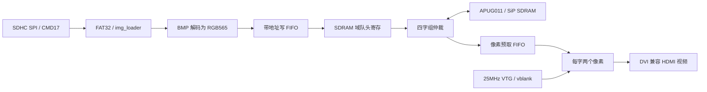

# S6 全链集成交接（2026-10-20）

本轮完成 SD 扇区服务 → FAT32 → BMP → SDRAM → HDMI 的 RTL 集成、可重复回归、候选 bit 和操作说明。**完整 640×480 仿真通过，DQM 修正候选已上板显示中央红块且整帧比较通过；SDRAM SiP 接口时序仍失败，S6 尚未完成最终时序与稳定性验收。**

本文取代旧架构草案、README 和历史交接中的过时实现状态。没有提交或推送 Git，也没有执行本版本板卡下载。

后续上板已收到 LED4/5/7 亮、数码管 `2110` 的反馈。真卡扇区回放确认旧程序不支持从 LBA0 直接开始的 FAT32 卷；现已补充该布局识别，保留 MBR 第一分区路径。真卡回放完整解码 307200 个像素、0 错误。诊断过程见 [SD 卡 2110 排查](sd_card_2110_2026-10-20.md)，修复版本仍须重新下载并实测。

随后用户用修复 bit 复测：LED4/5/0 亮、LED7 灭、数码管 `0010`，但图片为纯白，未出现中央红块；KEY15 应急红屏和蜂鸣正常。目前准备了独立整帧 SDRAM 读写自检 bit，等待板上读回结果，见 [纯白画面排查](white_frame_2026-10-20.md)。图片提交状态不能替代真实 SDRAM 数据正确性检查。

## 1. 完成内容与主要文件

后续排查进展：独立 SDRAM BIST 已由用户确认通过，未修正的完整通路连续读回版本为 7711、LED0/1/2/6 亮。真实控制核对照确认读取时 DQM 全屏蔽的代码缺陷；单项修正后完整 VGA 功能仿真通过，用户也已报告 **7777、LED0～5 亮、中央红块出现**。当前已验证文件为 `project/image_dm_fix_td_Runs/phy_1/image_dm_fix.bit`，见 [读取 DQM 修正](image_dm_fix_2026-10-20.md)。此前“仅有模型、尚待独立 BIST”的段落是历史状态。

| 文件 | 当前作用 |
|---|---|
| `rtl/storage/image_player.v` | 单帧装载、地址生成、整组写入、提交、最新请求排队、错误回落和重试 |
| `rtl/top/dmz_eg4s20_hdmi_top.v` | SD 启动探针、图片通路、播放控制、双 PLL、SiP 原语和 HDMI 的正式装配 |
| `rtl/storage/framebuf_arbiter.v` | 四字组互斥仲裁、同拍接受、刷新避让、重启排空握手和故障锁存 |
| `rtl/storage/pix_reader.v` | Gray 计数跨域、含在飞字的信用、垂直消隐重定位、RGB565 输出 |
| `rtl/storage/sdram_ctrl_wrap.v` | 真实 APUG011 加密核与行为模型的编译分流；修正模型掩码、刷新和组相位 |
| `rtl/common/async_fifo.v` | Gray 指针 FIFO；前进指针与比较预先计算，缩短使能到空满标志路径 |
| `rtl/video/video_timing_gen.v` | 增加与 `de` 同拍的 `vblank`，不再拿水平消隐的零坐标判断帧末 |
| `rtl/control/player_ctrl.v` | 0 基播放索引转换为 1 基装载索引，切图、轮播及模式控制 |
| `constraints/dmz_eg4s20_hdmi.sdc` | 自动派生时钟，仅独立 PLL 间分异步组，保留 SDRAM 0°/180°关系 |
| `project/hdmi_td.al`、`scripts/sync_src.ps1` | 登记并同步所需模块，工程副本经 lint 和哈希核对 |
| `sim/testbench/tb_image_player.v` | 真实解析、FIFO、仲裁、模型和 VTG 的集成测试，仅模拟外部扇区服务 |
| `sim/scripts/run_*_regression.ps1` | 三组独立仿真库、明确通过标记、失败退出、源文件 SHA256 证据 |
| `project/flow_s6_bit.tcl` | 全综合布线、时序/资源报告、候选 bit；负余量返回失败 |
| `scripts/check_s6_release.py` | 核对回归哈希、工程副本、时钟、构建时间与 bit，输出发布审计 JSON |
| `scripts/make_test_bmps.ps1` | 生成可直接放到 SD 卡的 IMG001/IMG002，均为 640×480 24bit BMP |

## 2. 数据流与提交机制



- **单缓冲**：装载时撤下旧图片并显示测试图。视频时序和 SD 驱动继续运行，存储路径两侧共同复位，各域同步释放。失去 SDRAM 域复位就同时复位 FIFO 两侧，显示状态下报错误 8，恢复后可重载。
- 根据 BMP 输出的 `pix_x/pix_y` 计算字地址，支持正高度 bottom-up 和负高度 top-down。写 FIFO 保存 `{21 位四字组地址, 4 位 DM, 32 位像素字}`。
- 收齐完整四字组才跨域发布组计数，组计数用 Gray 码。SD 字节稀疏不会使仲裁器过早补拍、跳过有效字。SDRAM 域再锁定组信用，队头寄存隔开 RAM 读复用器与命令路径。
- 完整图片必须有 `640×480` 个像素，实际接受 `153600` 条字写命令，并经过 15 拍写静默窗口，才发布 `image_ready`。这是控制器接口层提交条件，不能替代物理 SDRAM 写入正确性的实测。
- 像素读取在垂直消隐中依次停止新组、排空返回、读空 FIFO、请求帧首重启、等待明确完成，再预填。显示按独立 x/y 金标准检查，不能用 `valid` 自增掩盖移相。
- 读侧一次承诺四字，计数同时包含已返回和在飞字；Gray 解码、差值、阈值比较分拍。八字余量覆盖流水线内尚未反映的组，避免满 FIFO 后才停请求。
- 忙时保留最后一个切图请求；找不到图片、坏头、扇区失败、超时均不发布残帧，后续请求可以重试。

## 3. 接口和时序假设

| 项目 | 当前约定 |
|---|---|
| 显示 | 640×480，25MHz 像素、125MHz 串化；固定时序，无 EDID |
| SDRAM | 第二颗 PLL，约 150MHz 0°与180°；沿用 APUG011 配置和频率宏 |
| 两颗 PLL | 独立锁定，数据跨 Gray FIFO，事件跨电平/翻转同步器 |
| 复位 | FIFO 两侧必须共同断言，各域同步释放；不支持任意单侧复位自愈 |
| 写命令 | 四字组首址对齐；组内保持首址；DM=1 屏蔽，DM=0 写入 |
| 刷新 | 接受边沿 `ref_vld=1` 禁止命令；模型保存组相位，真加密核跨刷新相位仍待核实 |
| 返回 | 行为模型固定 10 拍，真核/真器件返回相位需实测 |
| 参数 | `image_player.WIDTH` 为 8 的倍数，帧字数小于 `2^18` 且在存储容量内；本版顶层固定 640×480 |
| 读取 FIFO | `12 <= LEVEL_HI`，`LEVEL_HI+4 <= 2^FIFO_AW`；本版深度512、阈值384 |
| SD 服务 | 块读取必须有有限超时；本版驱动支持 SDHC 块寻址，FAT32 512B 扇区 |
| 图库 | 编译参数 `GALLERY_COUNT=1`，允许配置连续 IMG001…IMG031；无自动扫描 |

## 4. 本轮验证证据

回归脚本在 `reports/s6_integration/` 下为各组建立独立 `work`。编译失败不运行旧库；运行结果须同时满足正向通过标记、错误扫描、有效检查数量、源哈希未漂移。`$finish` 和工具退出 0 本身均不代表通过。

| 回归 | 实际结果 |
|---|---|
| SD 严格协议，默认分频/默认大超时 | 通过，62 条 PASS；含主机中途复位、卡持续供电 |
| SD 严格协议，快速分频/小边界 | 通过，64 条 PASS |
| SD 驱动、启动探针 | 均通过，23/14 条 PASS |
| FAT32、BMP、img_loader、播放控制 | 均通过，40/37/43/85 条 PASS；FAT32 新增 LBA0 直接卷及误判防护 |
| 异步 FIFO | 24 checks，0 errors，8 cases |
| 仲裁器 | 46756 checks，0 errors，15 cases |
| SDRAM 行为模型 | 154771 checks，0 errors，12 cases |
| 像素读取，64×8 | 108 checks，0 errors，8 cases，含压力、下溢恢复与共同复位 |
| 像素读取，640×480 | 64 checks，0 errors，5 cases；逐像素扫描完整帧、变更内容、行地址隔离 |
| 图片全链，32×16 | 6202 checks，0 errors；11 类正常/异常场景 |
| 图片全链，640×480 | **614404 checks，0 errors**；完整底向上 BMP 装载和完整显示帧 |
| 静态检查 | 53 文件，E0/E1/E2 全为0 |
| SD 素材 | 两个 BMP 的签名、文件大小、尺寸、planes、24bit 和未压缩格式均经读取核对 |

11 类图片场景包括：正常 bottom-up、不同内容的 top-down 重载、缺图及重试、坏 BMP 头、截断文件、数据扇区失败、忙时最新请求、显示期间 SDRAM 异常、服务停滞超时及恢复、SD 启动失败恢复、SDRAM 域失锁后的两侧共同复位与重载。另在写接受边界注入刷新。

原始证据入口：

- [前端回归清单](../reports/s6_integration/frontend/result.json)
- [存储回归清单](../reports/s6_integration/storage/result.json)
- [全链回归清单](../reports/s6_integration/simulation/result.json)
- [全链 VGA 日志](../reports/s6_integration/simulation/image_player_full.txt)
- [最终发布审计](../reports/s6_integration/release_check.json)

### 综合、资源与时序

工程完成 elaborate、综合、布局、布线和 bitgen，候选文件为 `project/hdmi_td_Runs/phy_1/hdmi_td.bit`。最终报告见 [timing.txt](../reports/s6_integration/timing.txt)、[area.txt](../reports/s6_integration/area.txt)、[coverage.txt](../reports/s6_integration/coverage.txt)。

| 指标 | 最终值与范围 |
|---|---|
| 25MHz 同域建立余量 | +20.886ns |
| 125MHz 同域建立余量 | +6.081ns |
| 25→125MHz 同 PLL 路径 | +6.445ns，未切断检查 |
| 150MHz 同域建立余量 | **+0.102ns，0 违例端点** |
| 150MHz 同域保持余量 | +0.054ns |
| SDRAM 0°→180°接口 | **−3.537ns，32 个违例端点** |
| SDRAM 180°→0°接口 | **−7.232ns，32 个违例端点** |
| 全局 SWNS/HWNS | **−7.232ns / +0.023ns，整体未通过** |
| STA 覆盖率 | 99.82%；无缺失时钟、无重复时钟定义、无无效约束、无组合环 |
| 资源 | 7142 LUT / 3248 REG / 3 BRAM9K / 7 DSP / 2 PLL / 41 IO |

自研组合长路径已通过 Gray 组计数、水位流水线、饥饿阈值寄存、FIFO 指针预计算和写队头寄存缩短。LUT 从首轮11461降至7142（含后续 FAT32 直接卷支持），写缓冲推断为 BRAM。表中为修复 2110 后重新布线的结果，旧版同域建立余量为 +0.238ns。

剩余接口违例已做最小化复现：仅保留既有 `sdram_bringup_top`、PLL、APUG011 核和 SiP，使用只含主时钟与 `derive_clocks` 的约束，仍得到相同 **SWNS=−7.232ns**。输入清单和可重跑脚本在 [sdram_timing_audit](../reports/s6_integration/sdram_timing_audit/flow.tcl)，报告为该目录的 `timing.txt`。这表明剩余问题也存在于最小 SDRAM 拓扑，不能仅靠图片通路优化消除；具体是时钟/IO 路由、器件时序模型还是接入方式，尚未获得足够证据定论。

**历史更正**：旧 bring-up 的正余量曾切断 SDRAM 0°/180°关系，不能证明接口成立。本轮保留关系，不以异步组或任意多周期例外掩盖违例。工具仍有 PLL 反馈局部网络、移相时钟局部布线、SiP 自动输入延迟及普通 IO 缺少 delay 等告警，须继续核对。不能把 99.82% 覆盖率或 bitgen 成功当作硬件通过。

## 5. 如何重跑

以下命令从仓库根目录执行。本机 ModelSim 为 `D:\Quartus_APP\modelsim_ase\win32aloem`；三个仿真入口可用 `-ModelSimPath` 覆盖。

```powershell
powershell -ExecutionPolicy Bypass -File scripts/sync_src.ps1
powershell -ExecutionPolicy Bypass -File sim/scripts/run_frontend_regression.ps1
powershell -ExecutionPolicy Bypass -File sim/scripts/run_storage_regression.ps1 -FullVga -ReportDir reports/s6_integration/storage
powershell -ExecutionPolicy Bypass -File sim/scripts/run_image_regression.ps1 -FullVga
```

综合布线（工具失败时还须看日志中的 ERROR 和时序报告）：

```powershell
Push-Location project
$s6FlowPath = (Join-Path $PWD.Path 'flow_s6_bit.tcl').Replace('\','/')
& D:\TD_6_24_APP\bin\td_commands_prompt.exe $s6FlowPath *> ../reports/s6_build.txt
Pop-Location
python scripts/check_s6_release.py
```

当前预期构建日志包含 `S6_BIT_FLOW_DONE` 及 `S6_TIMING_FAILED`，发布审计返回非零，状态为 `blocked_by_sdram_timing`。这表示候选产物已生成、验收门槛没有通过。

只跑快速仿真可省略 `-FullVga`；发布审计则要求完整 VGA 证据齐备。修改源码后必须重跑受影响回归，脚本会拒绝旧哈希。`.ps1` 保持 UTF-8 BOM，其余源码/文档为 UTF-8 无 BOM。

## 6. SD 准备与操作

运行 `powershell -ExecutionPolicy Bypass -File scripts/make_test_bmps.ps1`，将 `assets/sd_images/IMG001.BMP` 放到 **FAT32、512 字节扇区的 SDHC 卡根目录**。支持 MBR 第一分区及 LBA0 直接 FAT32 卷两种布局。文件为 640×480、24bit、未压缩、921654 字节。无需额外处理器处理资源。

当前实测用卡在 LBA0 直接放置 FAT32 VBR，Windows 虽报告 `PartitionStyle=MBR`，但四个实际分区表项均为空，不能只凭这个属性判断有 MBR。卡根目录的 `IMG001.BMP` 使用 IMG002 的白底中央红块内容，以便区分内置测试图；文件内容和原始扇区读回均已校验一致。卡无需重做分区。

2110 修复候选 bit 生成于 2026-10-20 01:58:17，另复制为 `project/hdmi_td_Runs/phy_1/hdmi_sd_fat32_fix.bit` 便于下载时区分，内容与最新 `hdmi_td.bit` 一致。SHA256 和卡上文件校验结果见 `reports/sd_card_2110/bit.json`。

默认工程仅装载 IMG001。测试双图时再放入同目录的 IMG002，并将顶层参数 `GALLERY_COUNT` 设为2后重新综合。当前图片尺寸必须严格匹配；没有小图居中、缩放或图库自动枚举。

| 按键 | 行为 |
|---|---|
| KEY0 / KEY1 | 上一张 / 下一张，按配置图库数回绕；单图时重新装载同一张 |
| KEY2 | 自动轮播开关，按 `player_ctrl` 默认5秒间隔切换 |
| KEY3 | 日常→科普→应急→日常；日常与科普目前使用相同图库 |
| KEY15 | 应急直达，红屏并间歇蜂鸣；KEY3 可退出 |
| KEY4 / KEY5 | 测试图选择，仅装载、失败或像素未就绪时可见 |
| KEY6 | PWM 测试音静音切换，不控制蜂鸣器 |
| 复位键 | 重新启动 PLL、SD 探针和整个系统 |

LED 高电平亮。`LED[7:0]` 依次为：SD/图片失败、装载中、SDRAM PLL 锁定、HDMI PLL 锁定、应急、FIFO 异常、轮播启用、图片已提交。

四位数码管从左起显示：错误域（0正常/1 SD探针/2图片）、错误码、请求图片号低4位（十六进制）、测试图号。显示的图片号是请求号，忙时不一定是已提交号。

图片错误码：1=FAT定位失败，2=BMP头失败，3=扇区I/O失败，4=簇链异常，5=写入阻塞/溢出，6=SD启动失败，7=像素数不足，8=SDRAM仲裁故障/失锁，9=装载超时。错误域1的1…7沿用 SD 驱动定义，8为启动探针签名错误，详见 `sd_spi_ctrl.v`、`sd_probe.v`。

## 7. 尚未解决与验收边界

1. **SiP 时序是当前发布阻塞项**。须依据 EG4S20/TD 对该核的时序与路由要求处理 0°/180°接口，确认局部时钟、读捕获相位和工具自动注入的 SiP 延迟。现有证据不足以添加放宽例外。
2. 本轮全链使用 SDRAM 行为模型、外部模拟扇区服务；SD SPI 协议另有独立回归。**没有执行真实 SPI SD卡→真实加密 SDRAM核→HDMI 的联合硬件验证**。
3. 真核跨刷新时保留/重启四字组的行为、读数据±1拍差异，以及 PLL 实际锁定，都仍需验证。
4. 当前只有单帧缓冲；重载显示测试图。双缓冲无缝切换、自动图库扫描、热插拔均未实现，`sd_cd` 未参与运行控制。
5. HDMI 核仍走 DVI 兼容视频，**未嵌入 HDMI 音频**。PWM 为测试音，尚非 SD 音频播放链路。
6. FAT 文件索引接口为9位，旧实现中“1…999”表述与位宽不符且有常量截断告警；本顶层限制1…31不触发该范围，扩展前应专门修复并回归。
7. 键盘行序及 SD MOSI/MISO 的历史资料冲突保留原核实结论，仍以本板实测收口。

> **2026-10-21 补充（S6-2）**：本文件 §4 里存储链路的检查数（仲裁 46756 / 控制器 154771 / 像素 108 与 64 / 图片 6202 与 614404）来自旧一轮；其中仲裁与像素的 TB 其后被查实含**错误规格**（补拍 `dm=0` 极性反、"地址变化即组首"），旧"通过"不构成有效证据。三个 RTL 已按官方四拍契约重写，三套 TB 同时重写，新的检查数为仲裁 **50900** / 控制器 154771 / 像素 108 与 64，全部 0 error，证据在本机 `reports/s6_final*`（该目录按 `.gitignore` 不纳入版本控制，可用 `sim/scripts/run_storage_regression.ps1` 重跑复现）。缺陷清单与仍未通过的项见 [开发进度](progress.md) 的 S6-2 章节。**§7 的全部边界仍然有效，本轮没有新增时序或上板证据。**

## 8. 下一步

优先处理最小 SDRAM 工程中的相同 SiP 违例，形成有依据的时序闭环，再重跑全链构建与本文件的发布审计。随后实测最小 SDRAM 读写、真卡单图、方向与色序、连续切图/轮播、异常卡和长时间刷新稳定性。保存板卡照片、下载 bit 哈希及错误状态，完成 S6/S7 硬件验收后，再推进 HDMI 音频与双缓冲。
